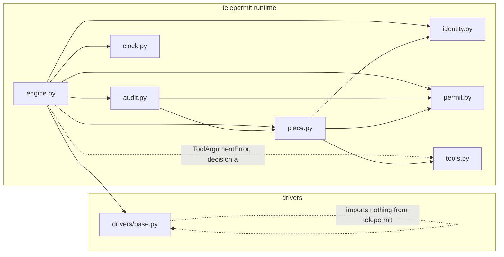

# Design Document

## Overview

This design covers the third building block of TelePermit: the Engine, the only module that executes tools. It also covers the supporting pieces that the Engine needs: the Clock, the audit Event models with `reduce_events` and the JSONL writer, the driver types in `drivers/base.py`, and the architecture test.

CONTRACTS sections 5, 6 and 7 and the golden traces of section 8 are binding. Section 5 was amended by the owner: the Engine constructor is `Engine(places, identity, permit, start_place, clock, enforce=True, *, scenario="", driver="scripted", task="")`, and the three keyword-only arguments are written only into the RUN_STARTED event. Requirement IDs in this document are the criteria 3.1 to 3.15 (criterion 3.N sits under Requirement N; criterion 3.15 is an owner-approved addition to the 14 seed items).

Scope limits:

- No scenario, no driver implementation, no CLI, no new dependency.
- No change to the Spec 1 or Spec 2 modules (`permit.py`, `identity.py`, `tools.py`, `place.py`).
- `SCHEMA_VERSION` is a replay-format constant. It is left to Spec 4 and not defined here.
- Two decisions in this design change CONTRACTS. The owner approved both, and the CONTRACTS amendment is pending (the owner applies it after tasks.md): a new status `ERROR` (decision a) and a clock without `advance` in `run` (decision d). See "Approved decisions with a pending CONTRACTS amendment".

Conventions for every new module under `backend/src/telepermit/`:

- Starts with a module docstring that names the CONTRACTS section it implements, then `from __future__ import annotations`.
- Python 3.12 is the development version. The code stays valid on 3.11, which is the declared minimum, so it uses no 3.12-only syntax.
- Frozen dataclasses with `slots=True` for values, `TypedDict` for JSON shapes, `Final` for constants.
- No `print`, no bare `except`, no mutable default arguments, no global mutable state, no commented-out code.
- Type hints on every public function. The clock is injected. Tool state lives on Place instances, so each run builds fresh places.

## Architecture

### Module and dependency diagram



Rules visible in the diagram:

- `engine.py` is the top of the runtime. Nothing imports `engine.py` except tests and later specs (scenario, CLI, recorder).
- `audit.py` does not import `engine.py`. This keeps the log models usable by the replay recorder and the CLI without importing the executor, and it avoids an import cycle.
- `drivers/base.py` imports only the standard library. It never imports `engine`, `identity`, `place`, `tools` or `permit`.
- `engine.py` imports `Identity` from `identity.py` only as a type. It never sees `Authority` or a private key.

### File list

| File | Purpose | New or changed |
|---|---|---|
| `backend/src/telepermit/clock.py` | `Clock` protocol, `TickClock`, `TICK_S` | new |
| `backend/src/telepermit/audit.py` | event constants, `Event`, JSON TypedDicts, `reduce_events`, `to_jsonl`, `write_jsonl` | new |
| `backend/src/telepermit/engine.py` | `AgentNotAlive`, `EngineState`, `RunResult`, `Engine`, `GO_COST`, `HARNESS_CAP` | new |
| `backend/src/telepermit/drivers/__init__.py` | package marker, docstring only | new |
| `backend/src/telepermit/drivers/base.py` | ONLY `Proposal`, `Observation`, `AgentDriver` | new |
| `backend/tests/test_architecture.py` | ast-based architecture checks and self-test | new |
| `backend/tests/unit/test_clock.py`, `test_audit.py`, `test_drivers_base.py`, `test_engine.py` | unit tests | new |
| `backend/tests/properties/test_engine_properties.py` | P3.1 to P3.9 | new |

### Where each shared constant lives (defined once)

| Constant | Module | Reason |
|---|---|---|
| `TICK_S = 1.0` | `clock.py` | It is a clock concept and the run loop imports it. |
| `GO_COST = 1`, `HARNESS_CAP = 30` | `engine.py` | Only the Engine meters a crossing or caps a run. |
| `SCHEMA_VERSION = 1` | not defined here | Replay format belongs to Spec 4. |
| Event types, statuses, denial reasons, kill reasons, `UNENFORCED` | `audit.py` | See the statuses note below. |
| `ADMIT`, `ADMIT_IMPOSED`, `REFUSE`, `OK`, `CLASS_NOT_ALLOWED`, `EXCEEDS_CEILING` | `place.py` (imported, not retyped) | Spec 2 already defines them. |
| `BAD_SIGNATURE`, `UNTRUSTED_AUTHORITY` | `identity.py` (imported when needed by tests) | Spec 2 already defines them. |

Statuses live in `audit.py`. Three reasons: `reduce_events` returns a status and `RUN_ENDED` carries one, both in `audit.py`; `engine.py` imports `audit.py`, so putting them in `engine.py` would force `audit.py` to import the engine and create a cycle; and the recorder and CLI can read statuses without importing the executor. The status string `HARNESS_CAP` and the cap constant `HARNESS_CAP = 30` share a name by CONTRACTS. To avoid a clash, every status constant in `audit.py` carries the `STATUS_` prefix (`STATUS_HARNESS_CAP` is the status string, `engine.HARNESS_CAP` is the cap of 30).

Literal status values (the strings that appear in `RUN_ENDED` data, in `EngineState.status` and in `reduce_events` output):

| Constant in `audit.py` | Literal value | Source |
|---|---|---|
| `STATUS_ALIVE` | `"ALIVE"` | CONTRACTS section 5 |
| `STATUS_KILLED` | `"KILLED"` | CONTRACTS section 5 |
| `STATUS_FINISHED` | `"FINISHED"` | CONTRACTS section 5 |
| `STATUS_REFUSED` | `"REFUSED"` | CONTRACTS section 5 |
| `STATUS_HARNESS_CAP` | `"HARNESS_CAP"` | CONTRACTS section 5 |
| `STATUS_ERROR` | `"ERROR"` | NEW. Approved (decision a). CONTRACTS amendment pending. |

The first five are the CONTRACTS values and are never renamed. `STATUS_ERROR` is approved (decision a). Until the owner applies the CONTRACTS amendment, CONTRACTS lists five statuses, so code and tests that use `ERROR` are written only after that amendment.

## Components and Interfaces

### clock.py (CONTRACTS section 5)

```python
TICK_S: Final = 1.0

class Clock(Protocol):
    def now(self) -> float: ...

class TickClock:
    def __init__(self, start: float = 0.0) -> None: ...
    def now(self) -> float: ...
    def advance(self, dt: float) -> None: ...
```

- `advance(dt)` raises `ValueError` when `dt` is negative, NaN or infinite. `dt == 0` is allowed. A non-number raises `TypeError` (from `math.isfinite`). Time never goes backwards, which supports security invariant 8.
- `TickClock(start)` raises `ValueError` for a non-finite `start`.
- `now()` returns the stored float. No wall clock is read anywhere.
- The `Clock` protocol is the type the Engine accepts (decision d, approved; CONTRACTS amendment pending). `advance` is an optional capability of a clock and is not part of the protocol.

### audit.py (CONTRACTS section 6)

Constants (all `Final`, defined once here):

- Event types (7): `RUN_STARTED`, `BORDER_CHECK`, `TOOL_CALL`, `DENIED`, `KILLED`, `FINISHED`, `RUN_ENDED`, and `EVENT_TYPES: frozenset[str]` holding them.
- Statuses (the 5 of CONTRACTS plus the approved `ERROR`): `STATUS_ALIVE`, `STATUS_KILLED`, `STATUS_FINISHED`, `STATUS_REFUSED`, `STATUS_HARNESS_CAP`, `STATUS_ERROR` (approved, decision a), and `STATUSES`. The status KILLED and the event type KILLED are different constants with the same string, and likewise FINISHED, so every status carries the `STATUS_` prefix and the event types keep their plain names.
- Denial reasons: `NOT_IN_PERMIT`, `NOT_IN_PLACE`.
- Kill reasons: `LIFETIME_EXCEEDED`, `STEPS_EXCEEDED`, `ALLOWANCE_EXCEEDED`.
- `UNENFORCED` (the BORDER_CHECK reason for a move with enforcement off).
- `PERMIT_FIELD_ORDER = ("lifetime_s", "max_steps", "allowance", "allowed_actions")`.
- Decisions and place reasons are imported from `place.py` (`ADMIT`, `ADMIT_IMPOSED`, `REFUSE`, `OK`, `CLASS_NOT_ALLOWED`, `EXCEEDS_CEILING`) and not retyped.

Types and functions:

```python
@dataclass(frozen=True, slots=True)
class Event:
    seq: int
    t: float
    type: str
    place: str
    step: int
    spent: int
    data: EventData            # union of the seven data TypedDicts

    def __post_init__(self) -> None: ...   # ValueError if type not in EVENT_TYPES
    def to_dict(self) -> dict[str, object]: ...

class ReducedState(TypedDict):
    place: str; step: int; spent: int; permit: PermitJSON; status: str

def permit_json(permit: Permit) -> PermitJSON: ...
def narrowed_fields(before: Permit, after: Permit) -> list[str]: ...
def reduce_events(events: Sequence[Event]) -> ReducedState: ...
def to_jsonl(events: Sequence[Event]) -> str: ...
def write_jsonl(path: str | Path, events: Sequence[Event]) -> None: ...
```

Behaviour:

- `Event.to_dict()` returns `{"seq", "t", "type", "place", "step", "spent", "data"}` with `data` as a shallow copy.
- `Event.data` is a plain dict inside a frozen dataclass, so it is not deep-frozen. The Engine builds a fresh dict for every event and never keeps or reuses a reference, so no later code can alter a recorded event by accident.
- `permit_json(permit)` builds the `PermitJSON` TypedDict from the Permit fields (`allowed_actions` as a sorted list). It does not call `Permit.to_json` because that method is typed `dict[str, object]`. A unit test asserts that the two give equal dicts, so Spec 1 and this module cannot drift apart.
- `narrowed_fields(before, after)` returns the names from `PERMIT_FIELD_ORDER` whose values differ, in that fixed order.
- `reduce_events` takes the `place`, `step` and `spent` snapshot from the last event, the permit from the last `RUN_STARTED` (`data["permit"]`) or `BORDER_CHECK` (`data["permit_after"]`), and the status from the last `RUN_ENDED` (`data["status"]`), otherwise `ALIVE`. It returns a fresh dict and a fresh `allowed_actions` list, so the caller cannot alias event data.
- Design choice: an empty list, or a list with no `RUN_STARTED`, raises `ValueError`. A log that does not start from `RUN_STARTED` has no defined permit, so inventing a default would hide a broken log.
- `to_jsonl(events)` returns `"\n".join(...)`-style output where every event is `json.dumps(event.to_dict(), sort_keys=True)` followed by `"\n"`. An empty list gives `""`. It keeps the default `ensure_ascii=True`, so the output is pure ASCII and cannot raise an encoding error on any string, including agent-supplied action strings.
- `write_jsonl(path, events)` writes `to_jsonl(events)` using `open(path, "w", encoding="utf-8", newline="\n")`. With `newline="\n"` Windows never turns `\n` into CRLF. It does not create parent directories.

### drivers/base.py (CONTRACTS section 7)

```python
@dataclass(frozen=True, slots=True)
class Proposal:
    action: str
    args: dict[str, str]

@dataclass(frozen=True, slots=True)
class Observation:
    task: str
    turn: int
    place: str
    tools: list[dict[str, object]]
    last_result: str | None

class AgentDriver(Protocol):
    def propose(self, observation: Observation) -> Proposal: ...
```

- The module holds exactly these three names and imports only `dataclasses` and `typing`. It imports nothing from `telepermit`.
- `Observation` has exactly five fields. A unit test compares `{f.name for f in dataclasses.fields(Observation)}` with `{"task", "turn", "place", "tools", "last_result"}`, so a permit, spend, cost, step count or key cannot be added by accident.
- `tools` is typed `list[dict[str, object]]` and not a `ToolSpec` TypedDict, because the seed limits this module to the three names above. Each entry is `{"name": str, "description": str, "args": dict[str, str]}`.
- `Proposal.args` is a dict inside a frozen dataclass, so it is not deep-frozen. The Engine copies it before logging it.

### engine.py (CONTRACTS section 5)

```python
GO_COST: Final = 1
HARNESS_CAP: Final = 30

class AgentNotAlive(RuntimeError): ...

@dataclass(frozen=True, slots=True)
class EngineState:
    status: str; place: str; steps: int; spent: int; permit: Permit

@dataclass(frozen=True, slots=True)
class RunResult:
    status: str; events: list[Event]; state: EngineState

class Engine:
    def __init__(self, places: Mapping[str, Place], identity: Identity, permit: Permit,
                 start_place: str, clock: Clock, enforce: bool = True, *,
                 scenario: str = "", driver: str = "scripted", task: str = "") -> None: ...
    @property
    def state(self) -> EngineState: ...      # fresh frozen snapshot on every access
    @property
    def events(self) -> list[Event]: ...     # copy of the log
    def step(self, proposal: Proposal) -> list[Event]: ...
    def run(self, driver: AgentDriver, task: str, max_turns: int = HARNESS_CAP) -> RunResult: ...
```

Private mutable fields (single underscore, set only inside the class): `_places` (a `dict` copy of the argument), `_identity`, `_clock`, `_enforce`, `_born`, `_status`, `_place`, `_steps`, `_spent`, `_permit`, `_events`, and `_task` (the constructor `task`, kept for the check of criterion 3.15). `_born` is assigned once in the constructor and never again. The dict keys of `places` are the place names the Engine uses; `Place.name` is not consulted.

The `clock` parameter is typed `Clock`, the protocol with only `now()`. `step` needs only `now()` (for `born`, the lifetime check and event times). `run` advances the clock by `TICK_S` only if the clock object has an `advance` method, so a `TickClock` works for `run` and a read-only clock works too. This is approved (decision d). CONTRACTS section 5 still has `run` call `clock.advance(TICK_S)` unconditionally until the owner applies the amendment.

Emitting events: one private `_emit(type, data)` creates `Event(seq=len(self._events), t=self._clock.now(), place=self._place, step=self._steps, spent=self._spent, data=data)` and appends it. Because the Engine updates its fields before it emits, every event carries the post-transition snapshot automatically. This is what makes the kill snapshots in the table below fall out without special cases.

`step` records `first = len(self._events)`, runs the algorithm and returns `self._events[first:]`, a fresh list of the events this call emitted.

#### Construction (spawn)

| # | Condition | State change | Events | Snapshot (place / step / spent) |
|---|---|---|---|---|
| C0 | `start_place not in places` | none | none; raises `ValueError` before anything else (design choice, decision e) | none |
| C1 | always | `_born = clock.now()`, status ALIVE, place = start_place, steps 0, spent 0, permit = constructor permit | `RUN_STARTED` with data `scenario`, `driver`, `enforce`, `task`, `identity` (`agent_id`, `agent_class`, `authority`, `issued_at`, `signature_hex`), `permit` (constructor permit as PermitJSON). Emitted in BOTH enforce modes. | start_place / 0 / 0 |
| C2 | `enforce` is False | none | none (no spawn border check, permit unchanged) | |
| C3 | `enforce` is True | `admission = places[start_place].admit(identity, permit, 0, 0, 0.0)` | `BORDER_CHECK` with data `place` = start_place, `via_action` = null, `decision`, `reason`, `permit_after`, `narrowed_fields`, `cost` 0, `explain` | start_place / 0 / 0 |
| C3a | decision is ADMIT or ADMIT_IMPOSED | `_permit = admission.permit_after`; `permit_after` in the event is that permit; `narrowed_fields = narrowed_fields(constructor permit, permit_after)` | | |
| C3b | decision is REFUSE | `_permit` unchanged; the event's `permit_after` is the agent's current permit (the Engine sets it, `Admission.permit_after` stays None); `narrowed_fields = []`; then status REFUSED | `RUN_ENDED` with status REFUSED, emitted after the BORDER_CHECK | start_place / 0 / 0 |

After C3b no tool can ever run, because `step` raises `AgentNotAlive` for any status other than ALIVE.

#### The eleven steps of `step(proposal)` with enforce=True

The steps run strictly in this order. The first branch that matches decides the result of the call. Action matching is exact string comparison with no stripping or case folding. An action is a `go` action when `action.startswith("go:")`, and its destination is `action[3:]`. The text `go:` with an empty destination is a go action with an unknown destination.

| # | Condition | State change | Event(s) emitted | Event snapshot (step / spent) |
|---|---|---|---|---|
| 1 | status is not ALIVE | none | none; raise `AgentNotAlive` | n/a |
| 2 | `elapsed = clock.now() - born`; `elapsed > permit.lifetime_s` (equal is allowed). Checked before `finish`. | status = KILLED (set BEFORE emitting) | `KILLED` {reason LIFETIME_EXCEEDED, action, limit = lifetime_s, observed = elapsed, explain}, then `RUN_ENDED` {KILLED} | step = steps before this attempt (not incremented), spent unchanged. Both events share it. |
| 3 | `action == "finish"` | status = FINISHED | `FINISHED` {}, then `RUN_ENDED` {FINISHED} | steps and spent unchanged; no cost, no step consumed |
| 4 | `steps + 1 > permit.max_steps` | status = KILLED | `KILLED` {reason STEPS_EXCEEDED, action, limit = max_steps, observed = steps + 1, explain}, then `RUN_ENDED` {KILLED} | step = steps before this attempt (not incremented), spent unchanged |
| 5 | always (the attempt survived 2 and 4) | `steps += 1` | none of its own; absorbed into the event of this call | n/a |
| 6 | `action not in permit.allowed_actions` | none | `DENIED` {action, reason NOT_IN_PERMIT, explain} | step includes the attempt, spent unchanged; nothing charged; status stays ALIVE |
| 7 | a tool name the current place does not hold (`not place.has_tool(action)`), or a go action whose destination is not a key of `places` or equals the current place | none | `DENIED` {action, reason NOT_IN_PLACE, explain} | step includes the attempt, spent unchanged; status stays ALIVE |
| 8 | `cost = GO_COST` for a go action, else `place.tool_cost(action)`; `spent + cost > permit.allowance` (equal is allowed) | status = KILLED; the action does NOT run; `spent` unchanged | `KILLED` {reason ALLOWANCE_EXCEEDED, action, limit = allowance, observed = spent + cost, explain}, then `RUN_ENDED` {KILLED} | step already includes the attempt (row 5), spent unchanged |
| 9 | always (row 8 passed) | `spent += cost` | none of its own | n/a |
| 10 | action is a tool | `result = place.execute(action, args)`. This is the only call to `execute` in the code base (invariant 1). | `TOOL_CALL` {action, args (a copy), cost, result} | step and spent after the cost |
| 10a (decision a, approved) | the call in row 10 raises `ToolArgumentError` | none beyond rows 5 and 9: the cost stays charged, the attempt keeps its step, status stays ALIVE | `TOOL_CALL` {action, args (a copy), cost, result = `"error: <message>"`} | same as row 10 |
| 10b (decision a, approved; needs the ERROR status in CONTRACTS) | the call in row 10 raises any other `Exception` | status = ERROR (set BEFORE emitting) | `RUN_ENDED` {ERROR} only, then the exception is re-raised unchanged out of `step` | step and spent as after rows 5 and 9 |
| 11 | action is a go action to a known, different place `p` | `admission = places[p].admit(identity, state.permit, steps, spent, elapsed)` with steps and spent AFTER the increments of rows 5 and 9 and `elapsed = clock.now() - born`. On ADMIT or ADMIT_IMPOSED: place = p, permit = `admission.permit_after`. On REFUSE: place and permit unchanged, status stays ALIVE. | `BORDER_CHECK` only (no TOOL_CALL): {place = p, via_action = action, decision, reason, permit_after, narrowed_fields, cost = 1, explain}. On REFUSE `permit_after` is the agent's current permit and `narrowed_fields` is `[]`. | place = p when admitted, else the current place; step includes the attempt; spent includes GO_COST in both cases |

Notes that follow from the table:

- KILL always means: set status KILLED first, then emit `KILLED`, then emit `RUN_ENDED(KILLED)`, both with the same snapshot. Nothing else runs in that call.
- A kill at row 2 or 4 never increments the step snapshot. A kill at row 8 already includes the attempt, because row 5 ran. This matches CONTRACTS section 6 and the Run B golden trace (KILLED at step 17, spent 38).
- Row 2 comes before row 3, so a `finish` proposed after the lifetime has run out is a kill, not a finish.
- A denial consumes a step and charges nothing. A `go` charges GO_COST even when the destination refuses it.
- Row 7 is reached only if row 6 passed. An action that is both outside the permit and outside the place is denied as NOT_IN_PERMIT.
- Row 11 admits with the agent's CURRENT permit (`state.permit`), not the permit the Engine was constructed with. Property P3.4 forces this reading: after the vault imposed a narrower permit, using the original home permit on a return crossing could hand the agent a wider permit than it holds. Using the current permit keeps `permit_after` no wider than the permit before the check (security invariant 6).
- `narrowed_fields` on ADMIT_IMPOSED is `narrowed_fields(state.permit before the check, permit_after)`.
- The `explain` strings are informative. They may name permits and limits because the audit log is not the agent's view. Tests never assert them exactly.
- A mid-run REFUSE at a border leaves the agent ALIVE (CONTRACTS section 5). The status REFUSED only arises at spawn.
- Rows 10a and 10b are approved (decision a). The `try` wraps only the `place.execute` call. `except ToolArgumentError` comes first. The next clause is `except Exception`, never a bare `except` and never `BaseException`. It sets the status ERROR, emits `RUN_ENDED(ERROR)` and uses a bare `raise`, so the caller sees the original exception and traceback. Rows 5 and 9 already ran, so the `RUN_ENDED(ERROR)` snapshot carries the incremented step and the charged spend, and `reduce_events` still equals `engine.state`. A later `step` raises `AgentNotAlive`.
- Exceptions raised anywhere else in `step` (for example from `admit` in row 11) are not caught. They are defects in the Engine or the Place. They propagate, and the log has no terminal event. This is a stated limitation.

#### The enforce=False variant

| Step | With enforcement off |
|---|---|
| 1 | Applies: non-ALIVE raises `AgentNotAlive`. |
| 2 | Skipped: no lifetime check. |
| 3 | Applies: `finish` ends the run with `FINISHED` then `RUN_ENDED(FINISHED)`. |
| 4 | Skipped: no step limit, never a kill. |
| 5 | Applies: `steps += 1`. Steps are still metered. |
| 6 | Skipped: `DENIED(NOT_IN_PERMIT)` is never emitted. |
| 7 | Applies: `DENIED(NOT_IN_PLACE)` is still emitted and still consumes the step. |
| 8 | Skipped: no allowance check, never a kill. Spend may exceed the permit allowance. |
| 9 | Applies: `spent += cost`, cost as in the enforced table (`GO_COST` for a go action). |
| 10 | Applies: tool runs and `TOOL_CALL` is emitted. Rows 10a and 10b (decision a, approved) apply too. |
| 11 | Replaced: the agent moves to `p` at once, with no `admit` call, so no identity or class check. Event `BORDER_CHECK` {place = p, via_action = action, decision ADMIT, reason UNENFORCED, permit_after = the unchanged permit, narrowed_fields `[]`, cost 1, explain}. Snapshot: place = p, step and spent after the increments. |

Construction with enforcement off emits only `RUN_STARTED`, with no spawn border check.

#### `run(driver, task, max_turns=HARNESS_CAP)`

```
if self._task and task != self._task: raise ValueError   # criterion 3.15, before any turn
if max_turns < 0: raise ValueError
last_result = None
for turn in 1..max_turns:
    if status != ALIVE: break
    advance = getattr(clock, "advance", None)    # decision (d), approved
    if callable(advance): advance(TICK_S)
    obs = Observation(task, turn, place, tools, last_result)
    proposal = driver.propose(obs)
    new_events = step(proposal)
    last_result = _last_result(new_events)
if status == ALIVE:
    status = HARNESS_CAP; emit RUN_ENDED(HARNESS_CAP)
return RunResult(status, events copy, state)
```

- `max_turns = 0` gives HARNESS_CAP immediately, with no driver call and no clock advance.
- Task consistency (criterion 3.15, an owner-approved addition): the Engine keeps the `task` it was constructed with. If that constructor `task` is non-empty and `run` is called with a different task, `run` raises `ValueError` before anything else: no clock advance, no driver call, no event and no state change, so a later `run` with the matching task still works. An empty constructor `task` (the default) means "unspecified", and `run` accepts any task. The check is a plain string comparison and runs before the `max_turns` check. CONTRACTS section 5 says only that `run(driver, task, ...)` takes its own `task` for the observation. The owner chose not to amend CONTRACTS for this check.
- An Engine already REFUSED, KILLED or FINISHED returns its status without calling the driver and without emitting an event (the loop breaks on the first check and the final `if` is false).
- After `run` returns, the status is never ALIVE, so an Engine is run once.
- `turn` is 1-based (decision f).
- If `step` raises (decision a, row 10b), `run` does not catch it. The status is ERROR and the exception propagates to the caller of `run`.
- `advance` is called only if the clock provides it (decision d, approved; CONTRACTS amendment pending). With a clock that has only `now()`, `run` still loops up to `max_turns` and the lifetime check sees whatever time the clock reports. Requirement 3.12 says "advancing the Clock by TICK_S". This design applies that to a clock that can be advanced.
- The RUN_ENDED(HARNESS_CAP) event carries the current snapshot.

Observation construction (private helper `_observe`):

- `tools`: first the current place's tools in the order of that Place's `tools` dict, each as `{"name": tool.name, "description": tool.description, "args": dict(tool.args)}`; then, for every OTHER place in the order of the `places` dict, `{"name": "go:<place>", "description": "Move to <place>.", "args": {}}`, never the current place; then `{"name": "finish", "description": "End the run.", "args": {}}`.
- All tools of the place are listed whatever the permit says. The agent never sees the permit, so the vault lists `export_records` even though the imposed vault permit denies it.
- Descriptions and result strings contain none of the words `permit`, `allowance`, `teleclick`, and no key material.

`_last_result(new_events)` is a pure function of the events the previous `step` call emitted. A step that leaves the agent ALIVE emits exactly one event, so the mapping is unambiguous:

| Previous step emitted | `last_result` |
|---|---|
| nothing yet (first turn) | `None` |
| `TOOL_CALL` | its `result` string |
| `DENIED` (either reason) | exactly `"DENIED: action '<action>' is not available to you here."` |
| `BORDER_CHECK` with decision ADMIT or ADMIT_IMPOSED (including UNENFORCED) | `"You are now in <place>."` with the destination from `data["place"]` |
| `BORDER_CHECK` with decision REFUSE | `"REFUSED at the border of <place>."` with no reason code |

## Data Models

### Event data shapes (CONTRACTS section 6)

```python
class PermitJSON(TypedDict):
    lifetime_s: float; max_steps: int; allowance: int; allowed_actions: list[str]

class IdentityJSON(TypedDict):
    agent_id: str; agent_class: str; authority: str; issued_at: float; signature_hex: str

class RunStartedData(TypedDict):
    scenario: str; driver: str; enforce: bool; task: str
    identity: IdentityJSON; permit: PermitJSON

class BorderCheckData(TypedDict):
    place: str; via_action: str | None; decision: str; reason: str
    permit_after: PermitJSON; narrowed_fields: list[str]; cost: int; explain: str

class ToolCallData(TypedDict):
    action: str; args: dict[str, str]; cost: int; result: str

class DeniedData(TypedDict):
    action: str; reason: str; explain: str

class KilledData(TypedDict):
    reason: str; action: str; limit: int | float; observed: int | float; explain: str

class FinishedData(TypedDict): ...   # no keys

class RunEndedData(TypedDict):
    status: str
```

`EventData` is the union of these seven. The `signature_hex` in `IdentityJSON` is a public signature, not key material. The Engine never holds a private key.

### Event fields

| Field | Meaning |
|---|---|
| `seq` | Index in the log, contiguous from 0. |
| `t` | `clock.now()` at emission. |
| `type` | One of the seven event types. |
| `place`, `step`, `spent` | Snapshot AFTER the transition the event describes. For a BORDER_CHECK that moved the agent, `place` is the destination; for a refused crossing it is the place the agent stays in, while `data["place"]` names the destination that was tried. |

### State and results

`EngineState` and `RunResult` are frozen dataclasses (see Components). `Engine.state` builds a new `EngineState` on every access, so callers cannot change the Engine through it. `Engine.events` returns a new list of the same immutable `Event` objects.

## Owner-approved design decisions

These were put to the owner, who took the recommended option in each case. They are settled.

| ID | Decision | Choice |
|---|---|---|
| (b) | Shape of the `go` and `finish` entries in `Observation.tools` | `{name: "go:<place>", description: "Move to <place>.", args: {}}` and `{name: "finish", description: "End the run.", args: {}}` |
| (c) | Where constants live | `TICK_S` in `clock.py`; `GO_COST` and `HARNESS_CAP` in `engine.py`; `SCHEMA_VERSION` left to Spec 4; no `constants.py` |
| (e) | Invalid arguments | `ValueError` for an unknown `start_place` (before any event), for `reduce_events` on an empty list or a list without `RUN_STARTED`, and for a negative `max_turns` |
| (f) | `Observation.turn` | 1-based |

The owner also asked to keep the `STATUS_` prefix for the status constants in `audit.py`. The literal values are listed in the statuses table above.

## Approved decisions with a pending CONTRACTS amendment

The owner approved (a) and (d) as written below. Neither is in CONTRACTS yet. The owner applies the CONTRACTS amendment after tasks.md is written. Until it is applied, CONTRACTS sections 5 and 6 do not list `ERROR` or the conditional `advance`, so the tasks that implement rows 10a and 10b, `STATUS_ERROR` and the conditional `advance` in `run` start only after the amendment is in place.

| ID | Decision | Why | CONTRACTS change (pending, applied by the owner) |
|---|---|---|---|
| (a) | Tool errors: Option A plus a fallback. (1) The Engine catches `ToolArgumentError` from `place.execute` and logs a `TOOL_CALL` with `result = "error: <message>"`. The cost stays charged, the attempt keeps its step, the status stays ALIVE. (2) For any other `Exception` from `place.execute`, the Engine sets the status ERROR (before emitting), emits `RUN_ENDED(ERROR)`, then re-raises the exception unchanged. | Steps and spent change in rows 5 and 9 before the tool runs. An exception afterwards would leave a changed state with no event, which breaks invariant 4 and P3.5. | A new status `ERROR`. Section 5: the status list gains `ERROR`. Section 6: the `RUN_ENDED` status list gains `ERROR`, and `TOOL_CALL.result` may be `"error: <message>"`. |
| (d) | The Engine accepts any object with `now()` (the `Clock` protocol). `run()` calls `advance(TICK_S)` only if the clock has an `advance` method. | `Clock` has only `now()`, but `run` must advance time. This avoids widening the protocol or adding a second one. | Section 5: `run` advances the clock by `TICK_S` only when the clock provides `advance`. |

Details of (a):

- The `try` wraps only the `place.execute` call (row 10).
- `except ToolArgumentError` comes first. The next clause is `except Exception`. It is never a bare `except` and never `BaseException`, so `KeyboardInterrupt` and `SystemExit` are not touched. It sets the status, emits `RUN_ENDED(ERROR)` and uses a bare `raise`, so the caller gets the original exception and traceback.
- The `RUN_ENDED(ERROR)` snapshot carries the incremented step and the charged spend, because rows 5 and 9 already ran. `reduce_events` therefore equals `engine.state` with status ERROR.
- `ERROR` is a terminal status. `step` on it raises `AgentNotAlive`.
- Limitation: exceptions raised anywhere else (from `admit` in row 11, from `driver.propose` in `run`, or from the Engine itself) are not caught. They propagate, and the log has no terminal event. The fallback could be widened to `driver.propose`. That is not part of the approved decision, to keep the amendment small.
- The scripted scenario never produces an ERROR replay. If one were ever recorded, the UI (Spec 5) would need a style for it.

Details of (d):

- `Engine.__init__` types `clock` as `Clock`. `step` only calls `now()`.
- `run` reads `advance = getattr(self._clock, "advance", None)` and calls it only if it is callable.
- With a `now()`-only clock, `run` still loops up to `max_turns`. Time is whatever the clock reports, for example an adapter that advances by itself.
- Requirement 3.12 reads "advancing the Clock by TICK_S". The design applies that to a clock that can be advanced. requirements.md is approved and not changed.

Suggested CONTRACTS text, kept for the owner to apply:

- Section 5, status line: "`status` is one of `ALIVE | KILLED | FINISHED | REFUSED | HARNESS_CAP | ERROR`. `ERROR` means a tool raised an exception other than `ToolArgumentError`; the Engine emits `RUN_ENDED(ERROR)` and re-raises."
- Section 5, `run`: "`clock.advance(TICK_S)` (only if the clock provides `advance`)".
- Section 6, `RUN_ENDED`: "`status` (`FINISHED`/`KILLED`/`REFUSED`/`HARNESS_CAP`/`ERROR`)". Section 6, `TOOL_CALL`: "`result` (string; `"error: <message>"` when the tool raised `ToolArgumentError`)".
## Security invariants

No invariant is changed. Each is mapped to the design element and the test that enforces it.

| # | Invariant | Design element | Enforcing test |
|---|---|---|---|
| 1 | Only `engine.py` calls `Place.execute`. | Row 10 is the only call site; `place.py` only defines `execute`. | `test_architecture.py::test_only_engine_calls_execute` and its self-test |
| 2 | `drivers/` never imports engine, identity (Authority), place or tools. | `drivers/base.py` imports only the standard library. | `test_architecture.py::test_drivers_do_not_import_runtime_modules` and its self-test; `test_drivers_base.py::test_base_imports_no_telepermit_modules` |
| 3 | Private keys never leave `Authority` and never appear in logs, observations, replays or errors. | The Engine receives an `Identity` (public signature) and never an `Authority`. `signature_hex` is public. Error messages are built from names and numbers only. | `test_engine.py::test_observations_contain_no_forbidden_words_or_signature`; `test_engine.py::test_run_started_identity_has_only_public_fields` |
| 4 | Every state transition emits exactly one event, in order, with contiguous `seq`. | `_emit` is the only writer of the log and reads the post-transition state. | P3.3 (Property 3). With decision (a), the ERROR path ends the log with `RUN_ENDED(ERROR)`, checked by `test_unexpected_tool_exception_sets_error_and_reraises`. |
| 5 | Limit checks happen BEFORE an action runs. | Rows 2, 4 and 8 precede rows 9 and 10. | P3.1 (Property 1); `test_allowance_one_over_kills_without_executing` |
| 6 | An imposed permit is never wider than the requested one. | Row 11 and the spawn use the current permit, and `Place.admit` narrows. | P3.4 (Property 4); `test_return_crossing_uses_current_permit` |
| 7 | A killed, finished or refused agent can never act again. | Row 1 raises `AgentNotAlive`. | P3.2 (Property 2); `test_step_after_refused_raises` |
| 8 | Counters (`step`, `spent`, born time) never reset or decrease, including across crossings. | Counters are only incremented; `_born` is set once; `TickClock.advance` rejects negative `dt`. | P3.4 (Property 4); `test_clock.py::test_advance_negative_raises` |
| 9 | The agent never sees its permit, its spend or any key. | `Observation` has exactly five fields; `last_result` strings follow the table above. | `test_drivers_base.py::test_observation_field_set_exactly_five`; `test_engine.py::test_observations_contain_no_forbidden_words_or_signature` |

## Architecture test design

`backend/tests/test_architecture.py` uses `ast` and has pure checker functions over a source string and a file name. The functions read no files, so the self-test can feed them snippets.

```python
BANNED_IN_DRIVERS = frozenset({"engine", "identity", "place", "tools"})

def check_driver_imports(source: str, filename: str) -> list[str]: ...
def check_no_execute_calls(source: str, filename: str) -> list[str]: ...
def is_engine_module(relative_path: Path) -> bool: ...   # True only for engine.py at the package root
def collect_sources(package_root: Path) -> list[Path]: ...
```

Each checker returns a list of violation strings of the form `"<filename>:<line>: <message>"`; an empty list means clean.

(a) `check_driver_imports` walks every `ast.Import` and `ast.ImportFrom` at any depth (so imports inside functions or `if TYPE_CHECKING` blocks count) and flags a node when it matches one of these:

| Form | Example | Rule |
|---|---|---|
| `Import` | `import telepermit.engine`, `import telepermit.engine as e`, `import telepermit.place.sub` | alias name starts with `telepermit.` and the second segment is banned |
| `Import`, bare | `import engine` | first segment is banned |
| `ImportFrom`, level 0, submodule | `from telepermit.engine import X` | module has `telepermit` as first segment and a banned second segment |
| `ImportFrom`, level 0, package | `from telepermit import engine` | module is `telepermit` and some imported name is banned |
| `ImportFrom`, relative submodule | `from .engine import X`, `from ..tools import Y` | `module` is set and its first segment is banned, whatever the level |
| `ImportFrom`, relative package | `from . import engine`, `from .. import place` | `module` is None and some imported name is banned, whatever the level |

Third-party names such as `anthropic.lib.tools` are not flagged because only the first segment (bare) or the second segment after `telepermit` is checked. `from telepermit.permit import Permit` and `from .base import Proposal` are not flagged.

(b) `check_no_execute_calls` flags every `ast.Call` whose `func` is an `ast.Attribute` with `attr == "execute"`. A `FunctionDef` named `execute` is not a call and passes, so `place.py` can define the method. It is applied to every `.py` file under `src/telepermit/` except `engine.py` at the package root (`is_engine_module`). A file named `engine.py` in a sub-package is NOT exempt. Tests are not scanned.

The walker `collect_sources` returns every `*.py` file under the package root. The test asserts that the set is non-empty and contains `engine.py`, `place.py` and `drivers/base.py`, and that the package root directory exists, so a wrong path can never make the test pass vacuously. The root is computed from the test file location (`Path(__file__).resolve().parents[1] / "src" / "telepermit"`).

Self-test: a table of deliberately bad snippets, one per import form above and one execute call (`place.execute("x", {})`, plus `Place.execute(p, "x", {})`), each asserted to return at least one violation. A table of good snippets (`import json`, `from telepermit.drivers.base import Proposal`, `from . import base`, `from .base import Observation`, `from telepermit.permit import Permit`, `class P:\n    def execute(self): ...`, `place.execute_plan()`) each asserted to return no violation. A check that `is_engine_module(Path("engine.py"))` is True and `is_engine_module(Path("drivers/engine.py"))` is False.

Honest limitation: this is a static check. It does not detect dynamic imports (`importlib.import_module`, `__import__`), `getattr(place, "execute")`, or aliasing such as `run = place.execute` followed by `run(...)`, because only direct attribute calls are examined. Attribute access through a bare `import telepermit` (for example `telepermit.engine.Engine`) is also not examined. The test reduces accidental breaches and is not a sandbox.

## Correctness Properties

*A property is a characteristic or behavior that should hold true across all valid executions of a system-essentially, a formal statement about what the system should do. Properties serve as the bridge between human-readable specifications and machine-verifiable correctness guarantees.*

Reflection on redundancy: the nine seed properties are kept as nine. P3.2 (kill semantics) and P3.3 (event counts) look related but check different things: what happens after the end versus how many events each call emits. P3.7 is a special case of the step-limit part of P3.1, but it checks the kill reason and the exact number of denials, which P3.1 does not. P3.5 subsumes the snapshot half of P3.3 only for the final state, so both stay. Criteria 3.3, 3.12, 3.13 and the boundary cases of 3.2, 3.4 and 3.7 are examples or static checks and are not properties (see Testing Strategy).

Common generators for all properties:

- World: built inline in the test file from the CONTRACTS section 8 numbers: library tools from `library_tools()`, vault tools from `vault_tools()`, ceilings library 60.0/30/60 with the six actions and vault 60.0/30/40 with `{read_records, go:library}`, allowed class `briefing-bot`, authority from `Authority.from_seed` (demo only), `TickClock(0.0)`, start place library. Every example builds fresh places.
- Action pool: `read_document`, `search_archive`, `read_records`, `export_records`, `go:vault`, `go:library`, `finish`, `bogus`, plus adversarial strings: `"unknown"`, `""`, padded `" read_records "`, a homoglyph such as `"read_recоrds"` (Cyrillic о), `"go:välts"`, `"go:"`, `"go:nowhere"`.
- Args: random dicts with keys from `name`, `query`, `destination` and arbitrary short text, values arbitrary text (valid under decision (a), because a missing key becomes a `TOOL_CALL` with an `error:` result).
- Permit: `lifetime_s` from `{0.0, 0.5, 1.0, 5.0, 60.0}` or a float in a small range, `max_steps` 0 to 40, `allowance` 0 to 80 with weight on small values and 0, `allowed_actions` a subset of the pool plus `go:nowhere` and the adversarial strings, drawn so the main strategy always includes `go:vault`.
- Step sequence: a list of up to 40 items, each a proposal plus an optional clock advance before it (dt from `{0.0, 0.5, 1.0, 30.0, 100.0}`), so the lifetime path is exercised.
- Enforce on for P3.1 to P3.7 and P3.9; enforce off for P3.8.
- The strategies skew toward small limits so most examples end in a kill. Where a property is an implication ("if the run reaches KILLED then ..."), the golden Run B unit test proves that a kill path exists, and no `assume` is used.

### Property 1: P3.1 - Counters stay within the current permit while ALIVE

For any valid permit and any sequence of proposals and clock advances with enforcement on, after construction and after every `step` call that leaves the status ALIVE, `state.spent <= state.permit.allowance` and `state.steps <= state.permit.max_steps`, where `state.permit` is the Engine's current permit (which may have been narrowed by a crossing).

Assertion: checked after every call. Docstring: `Property P3.1: ... Validates: Requirements 3.4, 3.5, 3.6, 3.7, 3.8`.

**Validates: Requirements 3.4, 3.5, 3.6, 3.7, 3.8**

### Property 2: P3.2 - After a kill the only further event is RUN_ENDED

For any valid permit and any sequence with enforcement on, if a `step` call produces a `KILLED` event, then that call emits exactly `KILLED` followed by `RUN_ENDED(KILLED)`, no event follows them, and every later `step` call with any proposal from the pool (and the adversarial strings) raises `AgentNotAlive` and leaves the log unchanged. The same holds after `FINISHED`.

Assertion: after the first kill, call `step` for each remaining proposal inside `pytest.raises(AgentNotAlive)` and compare `engine.events` before and after.

**Validates: Requirements 3.1, 3.7**

### Property 3: P3.3 - Exactly one event per transition and contiguous seq

For any valid permit and any sequence with enforcement on, `seq` over `engine.events` equals `0, 1, 2, ...` with no gap; construction emits exactly 2 events when the spawn is admitted (RUN_STARTED, BORDER_CHECK) and exactly 3 when it is refused; and every `step` call on an ALIVE agent emits exactly one event if the status stays ALIVE, and exactly two (a cause event `KILLED` or `FINISHED`, then `RUN_ENDED`) if the call ends the run. A call on a non-ALIVE agent emits zero events.

**Validates: Requirements 3.11**

### Property 4: P3.4 - Counters never decrease and permits never grow

For any valid permit and any sequence with enforcement on, across consecutive events of the log: `step`, `spent` and `t` never decrease; and across consecutive permit-carrying events (`RUN_STARTED` permit, then each `BORDER_CHECK` `permit_after`) each permit is no wider than the one before on every field (`lifetime_s <=`, `max_steps <=`, `allowance <=`, `allowed_actions` a subset). The same comparison holds for `state.permit` between calls.

**Validates: Requirements 3.8**

### Property 5: P3.5 - reduce_events equals the Engine's final state

For any valid permit and any sequence, either enforce mode, `reduce_events(engine.events)` equals `{place, step, spent, permit, status}` taken from `engine.state` (with the permit as `permit_json(state.permit)`). This is checked after every `step` call, so every prefix of the log is also covered. A refused spawn is covered by P3.9.

**Validates: Requirements 3.11, 3.14**

### Property 6: P3.6 - TOOL_CALL names a tool of the recorded place

For any valid permit and any sequence, for every `TOOL_CALL` event `e`, `places[e.place].has_tool(e.data["action"])` is true.

**Validates: Requirements 3.6**

### Property 7: P3.7 - A loop of denied actions ends in KILLED(STEPS_EXCEEDED)

For any valid permit with a small `max_steps` and any sequence of always-denied actions, driven through `step` directly with an un-advanced clock (so the lifetime cannot be the cause), the run ends with `KILLED(STEPS_EXCEEDED)`, the number of `DENIED` events equals the current permit's `max_steps` (0 when `max_steps` is 0), no tool is executed, and `spent` is 0.

Always-denied actions, with the agent never leaving the library: `bogus`, `""`, `" read_records "`, `"read_recоrds"`, `"go:"`, `"go:nowhere"`, `"go:välts"`, `"go:library"` (the current place) and the vault tools `read_records` and `export_records` (not held by the library). Each is denied as NOT_IN_PERMIT or NOT_IN_PLACE. `go:vault` is excluded. The expected count uses `engine.state.permit.max_steps` after construction, because the library ceiling may narrow the generated permit. The KILLED event has `limit == max_steps` and `observed == max_steps + 1`.

**Validates: Requirements 3.4, 3.5**

### Property 8: P3.8 - With enforcement off there is no kill and no permit denial

For any valid permit and any sequence with enforcement off (including a forged identity), the log contains no `KILLED` event, no `DENIED` event with reason `NOT_IN_PERMIT`, every `DENIED` has reason `NOT_IN_PLACE`, there is no spawn `BORDER_CHECK`, every `BORDER_CHECK` has decision `ADMIT`, reason `UNENFORCED`, `narrowed_fields == []` and `permit_after` equal to the unchanged permit, and `steps` and `spent` keep being metered.

That spend CAN exceed the allowance is an existential statement ("may"), so it is not a universal property. It is covered by a deterministic witness unit test (`test_unenforced_spend_exceeds_allowance_witness`).

**Validates: Requirements 3.10**

### Property 9: P3.9 - A forged identity at spawn gives exactly the three-event refusal

For any valid permit and any forged signature (random bytes of any length 0 to 128, or a valid signature with one bit flipped, never equal to the valid signature), with enforcement on and a trusted authority name, the log is exactly `RUN_STARTED`, `BORDER_CHECK` (decision REFUSE, reason BAD_SIGNATURE, `permit_after` equal to the RUN_STARTED permit, `narrowed_fields == []`, `cost == 0`, `via_action` null), `RUN_ENDED(REFUSED)`; the status is REFUSED; and any `step` raises `AgentNotAlive`.

**Validates: Requirements 3.9**

## Error Handling

| Situation | Behaviour | Event emitted |
|---|---|---|
| `step` on a non-ALIVE Engine | raise `AgentNotAlive` (message holds the status only) | none |
| Unknown `start_place` in the constructor | raise `ValueError` before any state is set (decision e) | none |
| `Event` built with a type outside the seven | raise `ValueError` | n/a |
| `TickClock.advance` with negative, NaN or infinite `dt` | raise `ValueError`; non-number raises `TypeError`; 0 allowed | n/a |
| `TickClock(start)` with non-finite `start` | raise `ValueError` | n/a |
| `reduce_events` on an empty list or a list without `RUN_STARTED` | raise `ValueError` (decision e) | n/a |
| `run` with negative `max_turns` | raise `ValueError` before any turn (decision e) | none |
| `run` with a task that differs from a non-empty constructor `task` | raise `ValueError` before any clock advance, driver call or event (criterion 3.15) | none |
| Limit breach (lifetime, steps, allowance) | status KILLED, action not run | `KILLED`, `RUN_ENDED` |
| Action outside permit or place | status stays ALIVE, step consumed, nothing charged | `DENIED` |
| Border REFUSE mid-run | agent stays, permit unchanged, GO_COST charged | `BORDER_CHECK` |
| Spawn REFUSE | status REFUSED | `BORDER_CHECK`, `RUN_ENDED` |
| `ToolArgumentError` from a tool (decision a, approved) | the cost stays charged, the attempt keeps its step, status stays ALIVE | `TOOL_CALL` with `result = "error: <message>"` |
| Any other `Exception` from a tool (decision a, approved; needs the ERROR status in CONTRACTS) | status ERROR, then the exception is re-raised unchanged | `RUN_ENDED(ERROR)` |
| Any exception from `driver.propose`, from `admit`, or elsewhere in `step` | propagates unchanged and is not caught (known limitation: the status stays ALIVE and the log has no terminal event) | none |
| Proposal args with non-string values | not validated by the Engine; the tool function decides | per tool |

No error message contains key material, the permit or the spend of an agent. Messages are built from status names, place names and numbers.

## Testing Strategy

### Approach

Property-based testing applies here. The Engine is deterministic, in-memory and cheap to run, with clear invariants over sequences of inputs. The library is Hypothesis (already a dev dependency), registered through `tests/conftest.py` with `deadline=None` and `max_examples=200`, which meets the 100-iteration minimum. Each of the nine correctness properties is implemented by exactly ONE Hypothesis test, tagged `Feature: engine-audit, Property <n>: <title>`, with a docstring of the form `Property P3.n: <statement>. Validates: Requirements 3.x`. Unit tests cover boundaries, the golden traces, the formats and the architecture checks.

Per `quality.md`: write each test first and see it fail for the expected reason; test boundaries explicitly (equal to the limit, one over, zero limits); never weaken or skip a test. Ruff conventions: `from __future__ import annotations` first, standard library imports, then a blank line, third-party imports (`pytest`, `hypothesis`, `cryptography`), then a blank line, then `telepermit` imports; line length 100; one trailing newline per file. Property tests contain no `print`.

### Test fixtures

Tests build their own world inline. There is no scenario module and no shared helper module. The world duplicates the CONTRACTS section 8 numbers in each test file that needs it, on purpose, so a change to a scenario can never silently change the tests:

- library tools via `library_tools()`, vault tools via `vault_tools()` (so the outbox and page counter are observable);
- ceilings: library `Permit(60.0, 30, 60, six actions)`, vault `Permit(60.0, 30, 40, {read_records, go:library})`;
- allowed class `briefing-bot` in both places;
- home permit `Permit(60.0, 30, 60, six actions)` with the six actions `read_document, search_archive, read_records, export_records, go:vault, go:library`;
- `Authority.from_seed("home-authority", b"telepermit-demo-authority")` (demo only), identity `briefing-bot-001`, class `briefing-bot`, `issued_at` 0.0;
- `TickClock(0.0)`, start place library.

A small replay driver class is defined inside `test_engine.py` (not under `drivers/`). It returns a list of `Proposal` objects in order, repeating the last, and records every `Observation` it receives. Two more small helpers live in the same file: a clock class with only `now()` (decision d) and a `Tool` whose function raises `RuntimeError` (decision a).

### Unit tests

`tests/unit/test_clock.py`: start value, advance by 1.0, advance by 0, negative `dt` raises `ValueError`, NaN and infinity raise `ValueError`, non-finite start raises, 30 ticks of `TICK_S` give exactly 30.0, `TICK_S == 1.0`.

`tests/unit/test_audit.py`: the seven event types; unknown type raises; `to_dict` fields; `permit_json` equals `Permit.to_json()`; `narrowed_fields` order; `reduce_events` on a hand-built Run B list returns `{place vault, step 17, spent 38, permit allowance 40, status KILLED}`; empty list raises; list without `RUN_STARTED` raises; no `RUN_ENDED` gives ALIVE; a hand-built `RUN_ENDED(ERROR)` gives status ERROR (decision a); permit from `RUN_STARTED` when no `BORDER_CHECK`; permit from the last `BORDER_CHECK`; the result does not alias event data; `to_jsonl` has one line per event, sorted keys, a trailing `"\n"` on every line, `""` for an empty list, and each line parses back with `json.loads`; `write_jsonl` writes bytes with no `b"\r"` and ending in `b"\n"` (read back in binary mode).

`tests/unit/test_drivers_base.py`: `Proposal` and `Observation` are frozen; the `Observation` field set is exactly `{task, turn, place, tools, last_result}`; `base.py` imports no `telepermit` module (checked with `ast`); a class with `propose` satisfies the `AgentDriver` protocol structurally.

`tests/unit/test_engine.py`:

- Construction and spawn: admitted spawn gives two events; imposed permit at spawn (start in vault with the home permit) gives `ADMIT_IMPOSED` and the narrowed permit; enforce off gives `RUN_STARTED` only; unknown start place raises `ValueError` and no event exists; `RUN_STARTED` data fields; Run C forged identity (signature of 64 zero bytes) gives exactly `RUN_STARTED`, `BORDER_CHECK` REFUSE BAD_SIGNATURE, `RUN_ENDED` REFUSED, status REFUSED, and `step` raises `AgentNotAlive`.
- Lifetime: exactly 60.0 allowed; 60.001 killed with `limit` 60.0 and `observed` 60.001 and the step snapshot not incremented; a `finish` after the lifetime is a kill, not a finish; lifetime 0 with elapsed 0 allowed.
- Finish: ends FINISHED with `FINISHED` then `RUN_ENDED`, steps and spent unchanged.
- Steps: with `max_steps` N the N-th step is allowed and the N+1-th is killed with `observed` N+1 and snapshot step N; `max_steps` 0 kills the first non-finish action; `finish` is still allowed with `max_steps` 0.
- Denials: NOT_IN_PERMIT consumes a step and charges nothing; NOT_IN_PLACE for a tool of the other place; `go:library` while in the library; `go:nowhere`; `go:` with an empty place; padded `" read_records "` is not matched (denied); NOT_IN_PERMIT wins when both reasons apply.
- Allowance: spend reaching exactly the allowance is allowed; one more is killed; the killed action did NOT execute (vault outbox empty or page counter unchanged) and `spent` is unchanged, with the step snapshot including the attempt.
- Crossing: GO_COST is charged and a BORDER_CHECK (no TOOL_CALL) is emitted; `ADMIT_IMPOSED` replaces the permit; a refusing destination keeps the agent in place, keeps the permit, charges 1 and carries the current permit as `permit_after`; a return crossing from the vault uses the current (narrowed) permit.
- Enforce off: no kill for lifetime, steps or allowance; NOT_IN_PLACE still denies and consumes a step; unenforced `go` emits `BORDER_CHECK(ADMIT, UNENFORCED)` with the unchanged permit and no identity check (forged identity still runs); `finish` still ends the run; the spend-above-allowance witness.
- Golden Run B (hand-driven through `step()`): all 20 events with exact types, step, spent and place; `BORDER_CHECK` vault `ADMIT_IMPOSED` with `narrowed_fields == ["allowance", "allowed_actions"]`; two `DENIED NOT_IN_PERMIT` at steps 3 and 4; twelve `TOOL_CALL read_records` at steps 5 to 16 and spent 5 to 38; `KILLED ALLOWANCE_EXCEEDED` at step 17, spent 38, limit 40, observed 41; the vault outbox empty; `reduce_events` equal to `{place vault, step 17, spent 38, permit allowance 40, status KILLED}`.
- Golden Run A (enforce off, via `run()` with the replay driver): 32 events, final status HARNESS_CAP, step 30, spent 120, two exports in the outbox, no `DENIED` and no `KILLED`.
- Run B via `run()` produces the same events as the hand-driven run apart from `t`.
- `run()`: 30 turns leave the clock at 30.0; `max_turns` 0 gives HARNESS_CAP at once with no driver call; `finish` mid-loop stops the loop; a REFUSED Engine returns REFUSED without a driver call; negative `max_turns` raises; a `run` task that differs from a non-empty constructor task raises `ValueError` before any driver call, clock advance or event, and a later `run` with the matching task works; an empty constructor task accepts any task; turns are numbered from 1; the tool listing order and the go and finish entries; the `last_result` mapping for a tool result, a denial, an admitted crossing and a refused crossing.
- Observations: across the Run A and Run B `run()` calls, no string in any Observation contains `permit`, `allowance` or `teleclick` (case-insensitive) or the identity signature hex.
- API shape: `state` returns a fresh snapshot each time; `events` returns a copy; `step` returns only the events of that call.
- Tool errors (decision a, approved):
  - `test_tool_argument_error_is_logged_as_tool_call_error`: a tool called without its required argument yields a `TOOL_CALL` whose result starts with `error:`, the cost stays charged, the step stays consumed, the status stays ALIVE, and the call emits exactly one event.
  - `test_unexpected_tool_exception_sets_error_and_reraises`: a Place holding a test `Tool` whose function raises `RuntimeError("boom")`. The `step` call raises that same `RuntimeError`. The status is ERROR. The call emitted exactly one event, `RUN_ENDED` with status ERROR, and no `KILLED` or `FINISHED` event. The snapshot step includes the attempt and spent includes the cost. `reduce_events(engine.events)` equals the `engine.state` values with status ERROR.
  - `test_step_after_error_raises`: a later `step` raises `AgentNotAlive`.
  - `test_base_exception_is_not_caught`: a tool that raises `KeyboardInterrupt` propagates it, and the Engine does not set ERROR.
  - `test_run_propagates_tool_exception_after_error_status`: `run` with a driver that proposes the raising tool lets the exception out, and the engine status is ERROR.
- Clock (decision d, approved): `test_run_with_now_only_clock_does_not_advance`: a clock with only `now()` runs through `run` to HARNESS_CAP with no `AttributeError`, and its reported time never changes.

`explain` strings are informative per CONTRACTS section 1 and are never asserted exactly.

### Property tests

`tests/properties/test_engine_properties.py` holds one test per property, named `test_p3_1_...` to `test_p3_9_...`, using the generators defined under Correctness Properties.

### Architecture test

`tests/test_architecture.py` as described in the Architecture test design section.

## Traceability

| Requirement | Module | Tests |
|---|---|---|
| 3.1 | `engine.py` | `test_engine.py::test_step_on_killed_raises`, `::test_step_on_finished_raises`, `::test_step_after_refused_raises`, `::test_step_after_error_raises` (decision a); `test_engine_properties.py::test_p3_2_*` |
| 3.2 | `engine.py` | `test_engine.py::test_lifetime_exactly_equal_is_allowed`, `::test_lifetime_just_over_is_killed`, `::test_finish_after_lifetime_is_a_kill`, `::test_lifetime_kill_does_not_increment_step_snapshot` |
| 3.3 | `engine.py` | `test_engine.py::test_finish_emits_finished_then_run_ended`, `::test_finish_changes_neither_steps_nor_spent` |
| 3.4 | `engine.py` | `test_engine.py::test_steps_nth_allowed`, `::test_steps_n_plus_one_killed`, `::test_max_steps_zero_kills_first_action`; `test_p3_1_*`, `test_p3_7_*` |
| 3.5 | `engine.py` | `test_engine.py::test_not_in_permit_consumes_step_charges_nothing`, `::test_padded_action_is_not_matched`; `test_p3_1_*`, `test_p3_7_*` |
| 3.6 | `engine.py` | `test_engine.py::test_not_in_place_for_other_places_tool`, `::test_go_current_place_denied`, `::test_go_unknown_place_denied`, `::test_go_empty_place_denied`, `::test_not_in_permit_wins_over_not_in_place`; `test_p3_1_*`, `test_p3_6_*` |
| 3.7 | `engine.py` | `test_engine.py::test_allowance_exact_is_allowed`, `::test_allowance_one_over_kills_without_executing`; `test_p3_1_*`, `test_p3_2_*` |
| 3.8 | `engine.py` | `test_engine.py::test_go_charges_cost_and_emits_border_check_only`, `::test_go_admit_imposed_replaces_permit`, `::test_go_refused_charges_cost_and_keeps_place_and_permit`, `::test_return_crossing_uses_current_permit`, `::test_golden_run_b_hand_driven`; `test_p3_1_*`, `test_p3_4_*` |
| 3.9 | `engine.py` | `test_engine.py::test_construct_enforced_admit_emits_two_events`, `::test_run_started_data_fields`, `::test_forged_identity_refused_run_c`, `::test_construct_unknown_start_place_raises_before_any_event`; `test_p3_9_*` |
| 3.10 | `engine.py` | `test_engine.py::test_unenforced_no_kill_on_any_limit`, `::test_unenforced_not_in_place_still_denies`, `::test_unenforced_go_border_check_unenforced`, `::test_unenforced_finish_ends_run`, `::test_unenforced_spend_exceeds_allowance_witness`, `::test_golden_run_a_via_run`; `test_p3_8_*` |
| 3.11 | `engine.py`, `audit.py` | `test_engine.py::test_step_returns_only_new_events`, `::test_golden_run_b_hand_driven`, `::test_tool_argument_error_is_logged_as_tool_call_error`, `::test_unexpected_tool_exception_sets_error_and_reraises` (decision a); `test_p3_3_*`, `test_p3_5_*` |
| 3.12 | `engine.py`, `clock.py` | `test_engine.py::test_run_thirty_turns_clock_at_thirty`, `::test_run_max_turns_zero_is_harness_cap`, `::test_run_finish_mid_loop`, `::test_run_on_refused_engine_skips_driver`, `::test_run_negative_max_turns_raises`, `::test_run_turns_are_one_based`, `::test_observation_tools_listing`, `::test_last_result_mapping`, `::test_observations_contain_no_forbidden_words_or_signature`, `::test_run_with_now_only_clock_does_not_advance` (decision d), `::test_run_propagates_tool_exception_after_error_status` (decision a); `test_clock.py::*` |
| 3.13 | `engine.py`, `drivers/base.py` | `test_architecture.py::test_only_engine_calls_execute`, `::test_drivers_do_not_import_runtime_modules`, `::test_checker_self_test_catches_bad_snippets`, `::test_checker_self_test_passes_good_snippets`, `::test_walker_is_not_vacuous`; `test_drivers_base.py::test_base_imports_no_telepermit_modules`, `::test_observation_field_set_exactly_five` |
| 3.14 | `audit.py` | `test_audit.py::test_reduce_events_golden_run_b`, `::test_reduce_empty_raises`, `::test_reduce_without_run_started_raises`, `::test_reduce_no_run_ended_is_alive`, `::test_reduce_permit_sources`, `::test_to_jsonl_format`, `::test_to_jsonl_empty`, `::test_write_jsonl_lf_only`; `test_p3_5_*` |
| 3.15 | `engine.py` | `test_engine.py::test_run_task_mismatch_raises_value_error`, `::test_run_task_mismatch_has_no_side_effects`, `::test_run_matching_task_is_accepted`, `::test_run_empty_constructor_task_accepts_any_task` |
