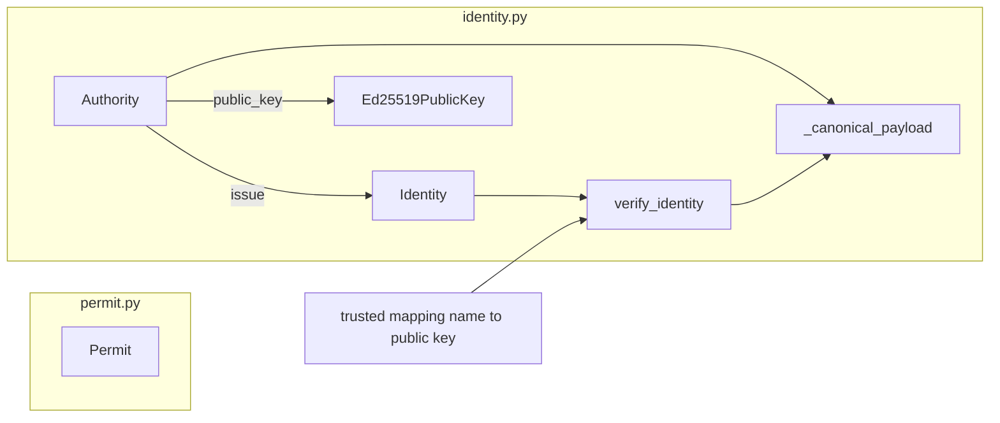
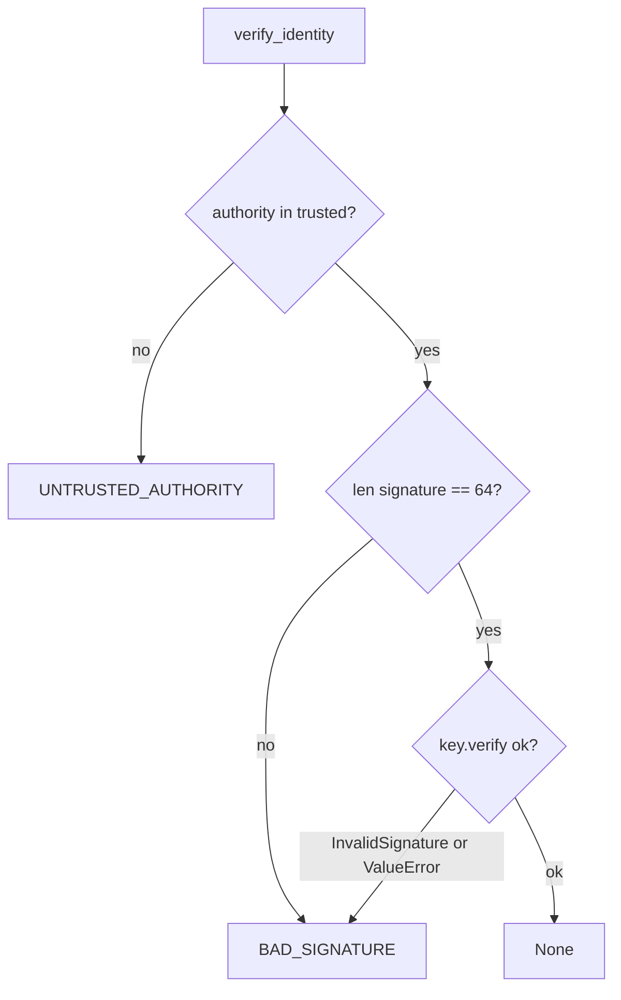

# Design Document

## Overview

This spec adds two pure library modules: `permit.py` (CONTRACTS section 2) and `identity.py` (CONTRACTS section 3). Both start with `from __future__ import annotations` and a module docstring that names their CONTRACTS section. Neither module does I/O or networking, and neither holds global mutable state. The only third-party dependency is `cryptography` (already in tech.md); `permit.py` uses the standard library only.

No conflict was found between requirements.md, the seed and CONTRACTS sections 2 and 3. One point is worth recording: CONTRACTS says the verifier returns `"BAD_SIGNATURE"` "otherwise". So an identity whose authority field was changed to a name that is still in `trusted` yields BAD_SIGNATURE. A name absent from `trusted` yields UNTRUSTED_AUTHORITY. The design follows that exactly.

Key decisions:

- Permit and Identity are frozen, slotted standard-library dataclasses. Pydantic is not needed here, and plain dataclasses keep `bytes` and `frozenset` handling simple.
- A single helper builds the canonical signed payload and is used by both `Authority.issue` and `verify_identity`. The two paths cannot drift apart.
- Result codes are module constants defined once.
- Verification is total. It checks length first, then catches only the exception types that `verify` is documented to raise.

Research note: the installed `cryptography` is 50.0.2. In this environment the Python wrapper for `Ed25519PublicKey.verify` is only an abstract signature (`verify(self, signature, data) -> None`), and the real implementation is compiled Rust, so its source cannot be read here. I also could not execute Python in the sandbox to probe wrong-length signatures empirically. The documented contract is that `verify` raises `cryptography.exceptions.InvalidSignature` when a signature does not validate. I have not confirmed that every wrong-length input raises `InvalidSignature` rather than `ValueError`. The design therefore does not depend on it. It rejects any signature whose length is not 64 before calling `verify`, and it catches both `InvalidSignature` and `ValueError` around the call. A unit test pins the behaviour for lengths 0, 1, 63, 65 and 200. P1.6 covers lengths 0 to 200 in general.

## Architecture



`permit.py` and `identity.py` do not import each other. Later specs (places, engine) will import both.

Verification decision order:



## Components and Interfaces

### permit.py (CONTRACTS section 2)

```python
@dataclass(frozen=True, slots=True)
class Permit:
    lifetime_s: float
    max_steps: int
    allowance: int
    allowed_actions: frozenset[str]

    def __post_init__(self) -> None: ...        # coercion + validation
    def narrowed_by(self, ceiling: Permit) -> Permit: ...
    def to_json(self) -> dict[str, object]: ...
    @classmethod
    def from_json(cls, data: Mapping[str, object]) -> Permit: ...
```

- `narrowed_by(ceiling)` returns a new Permit with `min(lifetime_s)`, `min(max_steps)`, `min(allowance)` and `allowed_actions & ceiling.allowed_actions`. It never mutates either input.
- `to_json()` returns `{"lifetime_s", "max_steps", "allowance", "allowed_actions"}`. `allowed_actions` is `sorted(...)`, a list.
- `from_json(data)` reads those four keys and calls the constructor, so it gets the same coercion and validation. Missing keys raise `KeyError`.

### identity.py (CONTRACTS section 3)

```python
UNTRUSTED_AUTHORITY: Final = "UNTRUSTED_AUTHORITY"
BAD_SIGNATURE: Final = "BAD_SIGNATURE"
_SIGNATURE_LEN: Final = 64

@dataclass(frozen=True, slots=True)
class Identity:
    agent_id: str
    agent_class: str
    authority: str
    issued_at: float
    signature: bytes

    @property
    def signature_hex(self) -> str: ...         # self.signature.hex()

def _canonical_payload(agent_id: str, agent_class: str, authority: str,
                       issued_at: float) -> bytes: ...

class Authority:
    __slots__ = ("name", "_Authority__key")
    def __init__(self, name: str) -> None: ...                 # random key
    @classmethod
    def from_seed(cls, name: str, seed: bytes) -> Authority: ...
    @property
    def public_key(self) -> Ed25519PublicKey: ...
    def issue(self, agent_id: str, agent_class: str, issued_at: float) -> Identity: ...

def verify_identity(identity: Identity,
                    trusted: Mapping[str, Ed25519PublicKey]) -> str | None: ...
```

`_canonical_payload` is exactly:

```python
json.dumps(
    {"agent_id": agent_id, "agent_class": agent_class,
     "authority": authority, "issued_at": issued_at},
    sort_keys=True, separators=(",", ":"),
).encode("utf-8")
```

`issue` signs `_canonical_payload(agent_id, agent_class, self.name, issued_at)`. `verify_identity` calls the same helper with the identity's own fields.

### Authority confinement (Requirement 1.7)

- The private key is held in one private attribute, `__key`, which Python name-mangles to `_Authority__key`. The class uses `__slots__`, so there is no instance `__dict__` to enumerate.
- Public attributes are `name`, `public_key` and the methods `issue` and `from_seed`. There is no accessor that returns private bytes and no method that calls `private_bytes`.
- `__repr__` returns `Authority(name='<name>')` using `repr(self.name)`. `__str__` returns the same string.
- Pickle and copy are blocked. `__reduce__` and `__reduce_ex__` raise `TypeError("Authority cannot be pickled or copied")`, and `__copy__` and `__deepcopy__` raise the same. This stops pickle, `copy.copy` and `copy.deepcopy` from serialising the key by accident.
- `from_seed(name, seed)` builds the key with `Ed25519PrivateKey.from_private_bytes(hashlib.sha256(seed).digest())`. Its docstring includes the text "DEMO ONLY", explains that the key is derived from a public, guessable seed, and says it exists so replays are byte-reproducible. The class docstring repeats the warning.
- Honest scope: this is a mitigation against accidental leakage through attributes, repr, str, logs and serialisation. It is not a sandbox. Python name privacy is not a security boundary, and code in the same process can still reach the key by mangled-name access or introspection tools such as `gc`. The security boundary relied on elsewhere is the import rule (drivers never import `Authority`), enforced by the architecture test in a later spec.

## Data Models

### Permit

| Field | Type | Rule |
|---|---|---|
| `lifetime_s` | float | `>= 0`; zero is valid |
| `max_steps` | int | `>= 0`; zero is valid |
| `allowance` | int | `>= 0`; zero is valid |
| `allowed_actions` | frozenset[str] | may be empty; coerced to `frozenset` |

Coercion and validation in `__post_init__` (using `object.__setattr__` because the dataclass is frozen):

- `allowed_actions`: any iterable of `str` (list, set, tuple, frozenset) is coerced to `frozenset`. A bare `str` is rejected with `TypeError`, so `"read"` is not silently turned into a set of characters.
- `lifetime_s`: an `int` (not `bool`) is coerced to `float`. So `Permit(5, ...)` equals `Permit(5.0, ...)`, and a JSON value `5` loads as `5.0`. Python's `json` module writes `5.0` as `5.0` and reads it back as a float, so the round trip is lossless. A non-finite value (NaN or infinity) is rejected with `ValueError`. NaN would defeat the `>= 0` check, and infinity is not valid JSON.
- `max_steps` and `allowance`: must be `int`. A `bool` is rejected with `TypeError`. CONTRACTS section 2 does not say anything about bool, so rejecting it does not conflict, and it prevents `True` being read as a limit of 1. A float is rejected with `TypeError`, so values are never truncated silently.
- Negative values for any of the three numeric fields raise `ValueError` with a message naming the field (Requirement 1.1).

### Identity

Frozen and slotted. Fields are `agent_id`, `agent_class`, `authority`, `issued_at` (float) and `signature` (bytes). `signature_hex` is `signature.hex()`, which is 128 hex characters for a 64-byte Ed25519 signature. Identity does no validation of its own. Verification must cope with arbitrary values, including a signature of any length.

### Trust mapping

`trusted: Mapping[str, Ed25519PublicKey]`. `Authority.public_key` returns the matching public key, derived from the private key on access.

### verify_identity behaviour

1. If `identity.authority` is not in `trusted`, return `UNTRUSTED_AUTHORITY`. This check comes first, so changing `authority` to a name absent from the map gives UNTRUSTED_AUTHORITY.
2. If `len(identity.signature) != 64`, return `BAD_SIGNATURE`. This is a defensive check made before calling `verify`.
3. Call `trusted[authority].verify(signature, _canonical_payload(...))` inside `try`. On `InvalidSignature` or `ValueError`, return `BAD_SIGNATURE`.
4. Otherwise return `None`.

Why it never raises for any signature length: step 2 means `verify` only ever sees 64-byte signatures. For those, the documented failure mode is `InvalidSignature`, which step 3 catches. `ValueError` is caught as a defence in depth. No bare `except` is used, and no other exception types are caught. The one remaining way to raise is a malformed `identity` or `trusted` argument (for example a non-hashable authority), which is outside Requirement 1.6, since that requirement covers signature bytes only.

## Correctness Properties

*A property is a characteristic or behavior that should hold true across all valid executions of a system-essentially, a formal statement about what the system should do. Properties serve as the bridge between human-readable specifications and machine-verifiable correctness guarantees.*

Prework reflection: criteria 1.1 (negative values), 1.7 (key confinement) and the DEMO ONLY docstring part of 1.8 are example or edge-case tests, not universal properties, so they are listed under unit tests below. Criteria 1.4 and 1.5 overlap, because a signature mutation test needs both the signing and verification paths. They are covered by P1.4 and P1.5 together. The seed lists seven properties, and all seven are kept.

### Property 1: P1.1 - Narrowing never widens

For any two valid Permits `p` and `c`, every numeric field of `p.narrowed_by(c)` is less than or equal to the same field in both `p` and `c`, and its `allowed_actions` is a subset of both inputs' `allowed_actions`.

**Validates: Requirements 1.2**

### Property 2: P1.2 - Narrowing is idempotent

For any two valid Permits `p` and `c`, `p.narrowed_by(c).narrowed_by(c) == p.narrowed_by(c)`.

**Validates: Requirements 1.2**

### Property 3: P1.3 - Permit JSON round trip

For any valid Permit `p`, `Permit.from_json(p.to_json()) == p`. The same holds when the dict is passed through `json.dumps` and `json.loads`. The `allowed_actions` list in `to_json()` is sorted.

**Validates: Requirements 1.3**

### Property 4: P1.4 - Any change to an identity or its signature fails verification

For any Identity issued by an Authority and trusted under its name, changing any one of `agent_id`, `agent_class`, `authority` or `issued_at`, or flipping any single bit of the signature, makes `verify_identity` return `BAD_SIGNATURE`. The unmodified identity verifies as `None`. For the `authority` mutation, the new name must remain in the trust map, mapped to the same public key, because a name absent from the map gives UNTRUSTED_AUTHORITY instead. The test generator must also ensure that the changed value really differs from the original.

**Validates: Requirements 1.4, 1.5**

### Property 5: P1.5 - Wrong key and empty trust map

For any Identity issued by an Authority, verifying it against a different Authority's public key registered under the same authority name returns `BAD_SIGNATURE`, and verifying it against an empty trust map returns `UNTRUSTED_AUTHORITY`.

**Validates: Requirements 1.5**

### Property 6: P1.6 - Verification never raises

For any trusted Identity and any signature bytes of length 0 to 200, `verify_identity` returns a result (`None`, `UNTRUSTED_AUTHORITY` or `BAD_SIGNATURE`) without raising an exception. Any signature that is not the genuine one returns `BAD_SIGNATURE`.

**Validates: Requirements 1.6**

### Property 7: P1.7 - Seeded determinism

For any seed bytes, two Authorities created with `from_seed` using the same name and seed produce byte-identical signatures for the same identity fields and equal public keys. For any two different seeds, the public keys differ.

**Validates: Requirements 1.8**

### Unit (example and edge-case) tests

| Test | Validates |
|---|---|
| Negative `lifetime_s`, `max_steps` or `allowance` each raise `ValueError` | 1.1 |
| Zero limits and empty `allowed_actions` construct successfully | 1.1 |
| Zero-limit boundaries in narrowing: narrowing by a zero permit gives zero fields, and equal values stay equal | 1.2 |
| `to_json` returns the four keys with a sorted list | 1.3 |
| Signature is 64 bytes, `signature_hex` has 128 hex characters, and the signature validates against the canonical payload | 1.4 |
| Valid identity returns `None`; unknown authority returns `UNTRUSTED_AUTHORITY`; changed authority name still in the map returns `BAD_SIGNATURE` | 1.5 |
| Signature lengths 0, 1, 63, 65 and 200 return `BAD_SIGNATURE` without raising | 1.6 |
| `repr`, `str`, `vars`-style attribute listing and `dir()` of an Authority contain no key material; pickle and copy raise `TypeError` | 1.7 |
| `Authority.from_seed.__doc__` contains "DEMO ONLY" | 1.8 |

## Error Handling

- Negative limits raise `ValueError` naming the field. Non-finite `lifetime_s` raises `ValueError`.
- Wrong types raise `TypeError`: `bool` or `float` for the int fields, a non-numeric `lifetime_s`, a bare `str` for `allowed_actions`.
- `from_json` raises `KeyError` for a missing key, and the constructor errors above for bad values.
- `verify_identity` never raises for any signature bytes. It returns a code. It catches exactly `InvalidSignature` and `ValueError`, and never uses a bare `except`.
- Error messages never include key material or signature contents.
- `Authority` pickle and copy attempts raise `TypeError`.

## Testing Strategy

Dual approach: example-based unit tests for boundaries and structure, and Hypothesis property tests for the seven universal properties.

- Library: Hypothesis (property tests) with pytest. Property tests are not implemented from scratch.
- `backend/tests/conftest.py` already registers and loads a profile with `deadline=None, max_examples=200`, which meets the 100-iteration minimum.
- Each property is implemented by a single Hypothesis test. Its docstring has the form `Property P1.n: <statement>. Validates: Requirements 1.x`. The tag **Feature: permit-identity, Property P1.n** appears in the docstring.
- Per quality.md, tests are written and confirmed failing for the expected reason before the implementation is written. Boundaries are tested explicitly: equal to the limit, one over the limit, and zero.
- No test touches the network, the clock or the file system. Authorities are generated in-memory. Seeds and identity fields come from Hypothesis strategies.
- Files:
  - `backend/tests/unit/test_permit.py`
  - `backend/tests/unit/test_identity.py`
  - `backend/tests/properties/test_permit_properties.py`
  - `backend/tests/properties/test_identity_properties.py`
- Verification commands: `uv --directory backend run pytest -q`, then `uv --directory backend run ruff check .`, then `uv --directory backend run ruff format --check .`.

## Traceability

| Requirement | Module | Test (file :: function) |
|---|---|---|
| 1.1 | permit.py | tests/unit/test_permit.py :: test_negative_values_raise_value_error, test_zero_limits_and_empty_actions_valid |
| 1.2 | permit.py | tests/properties/test_permit_properties.py :: test_p1_1_narrowing_never_widens, test_p1_2_narrowing_idempotent; tests/unit/test_permit.py :: test_narrowing_zero_and_equal_boundaries |
| 1.3 | permit.py | tests/properties/test_permit_properties.py :: test_p1_3_json_round_trip; tests/unit/test_permit.py :: test_to_json_shape_and_sorted_actions |
| 1.4 | identity.py | tests/properties/test_identity_properties.py :: test_p1_4_tampering_fails_verification; tests/unit/test_identity.py :: test_issue_signs_canonical_payload, test_signature_hex_length |
| 1.5 | identity.py | tests/properties/test_identity_properties.py :: test_p1_4_tampering_fails_verification, test_p1_5_wrong_key_and_empty_trust; tests/unit/test_identity.py :: test_verify_result_codes |
| 1.6 | identity.py | tests/properties/test_identity_properties.py :: test_p1_6_verify_never_raises; tests/unit/test_identity.py :: test_wrong_length_signatures_bad_signature |
| 1.7 | identity.py | tests/unit/test_identity.py :: test_authority_hides_key_material, test_authority_cannot_be_pickled_or_copied |
| 1.8 | identity.py | tests/properties/test_identity_properties.py :: test_p1_7_seeded_determinism; tests/unit/test_identity.py :: test_from_seed_docstring_says_demo_only |
