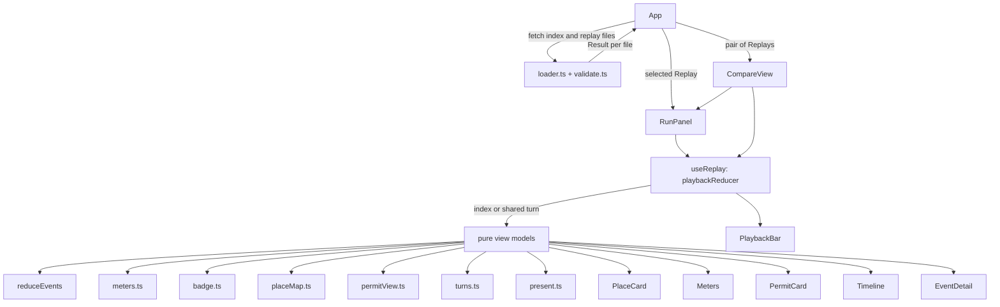
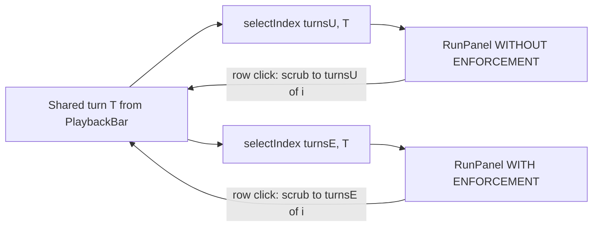

# Design Document

## Overview

The Timeline UI ("Mission Control") is a static React 19 + TypeScript page in `frontend/`. It loads the replay files of CONTRACTS section 9 by relative URL, reproduces `reduce_events` in TypeScript, and lets a viewer play, step, scrub and compare the recorded runs. It tells one story: the same prompt-injected briefing run without enforcement and with enforcement, where the enforced run ends in a KILLED event (red marker and border, amber text) that states the reason, the limit and the observed value.

Design principles:

- **Logic is pure, rendering is thin.** Every rule in the requirements (reduce, meters, border badge, token placement, permit view, turn mapping, playback, loader errors) is a pure function over plain data. These run in vitest's node environment with no DOM and no DOM test library (none is installed and none may be added).
- **The recorded files are the oracle.** Tests read the real files in `frontend/public/replays/` with `node:fs` and check the UI logic against them.
- **No new dependency.** `package.json` keeps react, react-dom, vite, vitest, typescript and the existing type packages. There is no property-testing library. Random inputs come from a small in-repo Seeded_Generator (mulberry32) that lives under `src/test/` and is never imported by app code.
- **No network except own files.** The only requests are `./replays/index.json` and `./replays/<file>` for entries named in the index. System fonts only. No `dangerouslySetInnerHTML`: replay text (including `meta.document_text`, which contains the injected instruction) is only ever rendered as React text.
- **Honest labelling.** Every replay is labelled "scripted agent" or "live LLM" from its `driver` field, and a permanent note says an injection that stays inside the permit is not stopped. UI wording is limited to the terms of docs/UI_BRIEF.md section 9 (permit, place, teleclick, "the engine destroyed the agent", the year 1994 in a subtitle).

### Research findings that shape the design

| Finding | Source | Effect on the design |
|---|---|---|
| `reduce_events` takes snapshot fields from the last event, the permit from the last `RUN_STARTED`/`BORDER_CHECK` (a `BORDER_CHECK` before any `RUN_STARTED` is skipped), the status from the last `RUN_ENDED` (else ALIVE), raises on an empty list or no `RUN_STARTED`, and returns copies. | `backend/src/telepermit/audit.py` | `reduce.ts` mirrors it line for line (section 3). |
| Spawn-time `BORDER_CHECK` has `via_action: null`; the unenforced run has no spawn check; `go:vault` unenforced is `ADMIT` with reason `UNENFORCED`. | CONTRACTS 5, 6 | Turn derivation and badge rules key on `via_action` and `reason`. |
| `forged-identity-refused` has `place: "library"` on all three events although the agent was never admitted. | real file | Token placement needs a spawn-refusal rule; `place` alone is not enough. |
| All three real replays have `meta.scenario = "poisoned_briefing"`; two of them have `enforce: true`. | real files, `index.json` | "Same scenario" alone cannot identify the compare pair, so pairing also uses the id suffix and id stem (Requirements 7.2, 7.11, 7.12). See "Compare pair resolution". No pair field is added to the replay format. |
| The enforced run peaks at `spent` 38 and is killed with `limit` 40, `observed` 41 (the killing call is not applied). The unenforced run reaches `spent` 120. | real files | Meter statements in section "Meters" and the worked table. |
| `@types/node` is not installed. | `frontend/node_modules/@types` | A minimal ambient declaration `src/test-types/node-fs.d.ts` types the `node:fs` functions the tests need. No dependency is added. |
| `vite.config.ts` already sets `base: './'` and the vitest `environment: 'node'`. | `frontend/vite.config.ts` | Only the `test.include` glob is added (`src/**/*.test.ts`). `base` and `environment` stay unchanged. |

## Architecture

### Layout under `frontend/src`

```
frontend/src/
  main.tsx                 existing entry
  App.tsx                  shell: load state, selected replay, single or compare mode
  styles.css               the one stylesheet (CSS variables from UI_BRIEF section 2)
  constants.ts             SCHEMA_VERSION, REPLAY_BASE, TICK_MS, SPEEDS, HONESTY_NOTE, labels
  types.ts                 replay and event types (CONTRACTS 6 and 9)          [pure]
  validate.ts              unknown -> Result<ReplayIndex | Replay, LoadError>   [pure]
  loader.ts                fetch (injected) + validate -> LoadError values       [pure given a fetch]
  reduce.ts                reduceEvents                                          [pure]
  meters.ts                barPercent, isOver, meterRows                         [pure]
  turns.ts                 turnsOf, lastTurn, selectIndex, sharedMax             [pure]
  pair.ts                  resolveComparePair                                    [pure]
  placeMap.ts              tokenPlace                                            [pure]
  contrast.ts              contrastRatio, compositeOver (WCAG 2.x formula)       [pure]
  badge.ts                 borderBadge                                           [pure]
  permitView.ts            permitView                                            [pure]
  present.ts               eventTone, eventLabel, eventSummary, statusView,
                           liveMessage, positionLabel, driverLabel, cursorBlinks [pure]
  playback.ts              createPlayback, playbackReducer                       [pure]
  useReplay.ts             React hook: reducer + tick interval                   [DOM]
  useMediaQuery.ts         React hook over matchMedia                            [DOM]
  components/
    PlaceCard.tsx  Meters.tsx  PermitCard.tsx  Timeline.tsx  EventDetail.tsx
    ReplayPicker.tsx  PlaybackBar.tsx  StatusLine.tsx  CompareView.tsx
    RunPanel.tsx  Note.tsx  ErrorState.tsx
  test-types/
    node-fs.d.ts           ambient types for node:fs (test-only, never imported by app code)
  test/
    seeded.ts              Seeded_Generator (test-only)
    replays.ts             reads the real replay files with node:fs (test-only)
  *.test.ts                beside the logic they test
```

Pure and testable without a DOM: `types`, `validate`, `loader` (with an injected fetch), `reduce`, `meters`, `turns`, `pair`, `placeMap`, `badge`, `permitView`, `present`, `contrast`, `playback`. Only `useReplay.ts`, `useMediaQuery.ts`, `components/*`, `App.tsx` and `main.tsx` touch React or the DOM. Components contain no decisions: each one calls a pure function and renders the returned view model. Component rendering is covered by `npm --prefix frontend run build` (tsc strict) plus tests of the view-model functions.

### Component and data flow



### Loading strategy

Requirements 1.2 and 1.9. `App` loads `./replays/index.json`, then loads **every** file named in the index in parallel and keeps one `Result` per file. Reasons: the Compare_Pair is found from the ids and `meta.scenario` of the loaded files (the index has no scenario), the files are a few kilobytes each, and one broken file must not hide the others. Every request is still one of the own files named in the index (Requirement 10.1).

Failure isolation (Requirement 1.9):

- A failure of the index is a full-page error (Requirement 1.2 cannot be met without it).
- A failure of one replay file does not affect the others. The picker still lists every index entry. The error for a broken file is shown only when that replay is selected (`ErrorState` in place of the run view). Other replays stay playable.
- The compare view becomes unavailable only if the broken file belongs to the Compare_Pair (an `-enforced` or `-unenforced` entry whose counterpart failed to load); a broken unrelated file, such as `forged-identity-refused`, leaves compare available.

### Selecting the replay and the mode

`App` state: `selectedId: string`, `mode: 'single' | 'compare'`. The default selection is the first index entry. `RunPanel` and `CompareView` are mounted with `key` set to the replay id (single) or the pair key (compare), so playback state is created fresh and paused at 0 whenever the replay or the mode changes (Requirement 6.1, 10.7: no autoplay).

## Components and Interfaces

### 1. `types.ts`

Matches CONTRACTS sections 6 and 9 exactly. No `any`.

```ts
export type Driver = 'scripted' | 'llm';
export type PermitField = 'lifetime_s' | 'max_steps' | 'allowance' | 'allowed_actions';
export type BorderDecision = 'ADMIT' | 'ADMIT_IMPOSED' | 'REFUSE';
export type DeniedReason = 'NOT_IN_PERMIT' | 'NOT_IN_PLACE';
export type KilledReason = 'LIFETIME_EXCEEDED' | 'STEPS_EXCEEDED' | 'ALLOWANCE_EXCEEDED';
export type RunStatus = 'FINISHED' | 'KILLED' | 'REFUSED' | 'HARNESS_CAP' | 'ERROR';
export type StateStatus = 'ALIVE' | RunStatus;

export interface PermitJSON {
  lifetime_s: number;
  max_steps: number;
  allowance: number;
  allowed_actions: string[];
}

export interface IdentityJSON {
  agent_id: string;
  agent_class: string;
  authority: string;
  issued_at: number;
  signature_hex: string;
}

export interface RunStartedData {
  scenario: string;
  driver: Driver;
  enforce: boolean;
  task: string;
  identity: IdentityJSON;
  permit: PermitJSON;
}
export interface BorderCheckData {
  place: string;
  via_action: string | null; // "go:<p>", or null at spawn
  decision: BorderDecision;
  reason: string;            // OK, UNENFORCED, BAD_SIGNATURE, UNTRUSTED_AUTHORITY, CLASS_NOT_ALLOWED, EXCEEDS_CEILING
  permit_after: PermitJSON;
  narrowed_fields: PermitField[];
  cost: number;
  explain: string;
}
export interface ToolCallData {
  action: string;
  args: Record<string, string>;
  cost: number;
  result: string;
}
export interface DeniedData { action: string; reason: DeniedReason; explain: string }
export interface KilledData {
  reason: KilledReason;
  action: string;
  limit: number;
  observed: number;
  explain: string;
}
export type FinishedData = Record<string, never>;
export interface RunEndedData { status: RunStatus }

interface EventBase {
  seq: number;
  t: number;      // clock time; born time is 0.0
  place: string;  // snapshot AFTER the transition
  step: number;
  spent: number;
}
export interface RunStartedEvent extends EventBase { type: 'RUN_STARTED'; data: RunStartedData }
export interface BorderCheckEvent extends EventBase { type: 'BORDER_CHECK'; data: BorderCheckData }
export interface ToolCallEvent extends EventBase { type: 'TOOL_CALL'; data: ToolCallData }
export interface DeniedEvent extends EventBase { type: 'DENIED'; data: DeniedData }
export interface KilledEvent extends EventBase { type: 'KILLED'; data: KilledData }
export interface FinishedEvent extends EventBase { type: 'FINISHED'; data: FinishedData }
export interface RunEndedEvent extends EventBase { type: 'RUN_ENDED'; data: RunEndedData }
export type ReplayEvent =
  | RunStartedEvent | BorderCheckEvent | ToolCallEvent | DeniedEvent
  | KilledEvent | FinishedEvent | RunEndedEvent;

export interface ReplayMeta {
  id: string;
  title: string;
  scenario: string;
  driver: Driver;
  enforce: boolean;
  harness_cap: number;
  task: string;
  home_permit: PermitJSON;
  ceilings: Record<string, PermitJSON>; // library, vault
  tool_costs: Record<string, number>;
  document_text: string;
  generated_by: string; // "scripts/record_replays.py" or "telepermit.cli"
}
export interface Replay {
  schema_version: 1;
  meta: ReplayMeta;
  events: ReplayEvent[];
}

export interface ReplayIndexEntry {
  id: string;
  title: string;
  file: string;
  driver: Driver;
  enforce: boolean;
}
export interface ReplayIndex { schema_version: 1; replays: ReplayIndexEntry[] }

export interface ReducedState {
  place: string;
  step: number;
  spent: number;
  permit: PermitJSON;
  status: StateStatus;
}

export type LoadErrorKind =
  | 'network' | 'http' | 'invalid_json' | 'schema_version' | 'missing_field' | 'invalid_field';
export interface LoadError {
  file: string;       // e.g. "./replays/index.json"
  kind: LoadErrorKind;
  message: string;    // names the file and the cause
  status?: number;    // kind 'http'
  field?: string;     // kinds 'missing_field', 'invalid_field' (e.g. "meta.home_permit.allowance")
}
export type Result<T, E> = { ok: true; value: T } | { ok: false; error: E };
```

The union is discriminated by `type`, so `event.data` narrows without casts.

### 2. `constants.ts`

Each constant is defined once and imported.

```ts
export const SCHEMA_VERSION = 1;
export const REPLAY_BASE = './replays/';
export const INDEX_URL = './replays/index.json';
export const TICK_MS = 800;              // base interval; real interval = TICK_MS / speed
export const SPEEDS = [1, 2, 4] as const;
export type Speed = (typeof SPEEDS)[number];
export const DEFAULT_SPEED: Speed = 1;
export const NARROW_QUERY = '(max-width: 767.98px)';
export const REDUCED_MOTION_QUERY = '(prefers-reduced-motion: reduce)';
export const SAFE_REPLAY_FILE = /^[A-Za-z0-9][A-Za-z0-9._-]*\.json$/;
export const HONESTY_NOTE =
  'Permits do not stop an injection that stays inside the permit boundary. ' +
  'Recorded runs are labelled scripted or live LLM.';
export const SUBTITLE = 'Permits and places, 1994. Limits enforced by the runtime, not the prompt.';
export const DRIVER_LABEL: Record<Driver, string> = { scripted: 'scripted agent', llm: 'live LLM' };
export const PLACES = ['library', 'vault'] as const;
```

### 3. `reduce.ts`: `reduceEvents`

```ts
export function reduceEvents(events: readonly ReplayEvent[]): ReducedState;
```

Behaviour, identical to the Python function:

1. Empty list: `throw new Error('cannot reduce an empty event list')`.
2. Scan forward once with `permit: PermitJSON | null = null` and `status: StateStatus = 'ALIVE'`.
   - `RUN_STARTED`: `permit = event.data.permit`.
   - `BORDER_CHECK` and `permit !== null`: `permit = event.data.permit_after`. A `BORDER_CHECK` with `permit === null` is ignored.
   - `RUN_ENDED`: `status = event.data.status`.
3. `permit === null` after the scan: `throw new Error('the event list has no RUN_STARTED event')`.
4. Return `{ place, step, spent }` from the last event, the permit and the status. The permit is copied (`allowed_actions: [...permit.allowed_actions]`), so the result shares no data with the events. Mutating the result never changes an event.

All view models that need "the state permit at the Playback_Index" call `reduceEvents(events.slice(0, index + 1))`. The loader guarantees `events[0].type === 'RUN_STARTED'`, so this never throws for a loaded replay. Cost is O(n) per render with n at most about 30; no memoisation is needed beyond `useMemo` on `(replay, index)`.

### 4. `playback.ts` and `useReplay.ts`

`playback.ts` is a pure reducer. It works on a position `pos` in `[0, max]`; in single mode `pos` is the Playback_Index and `max = max(events.length - 1, 0)`, in compare mode `pos` is the shared turn and `max` is the largest last turn of the two replays (section "Compare view").

```ts
export interface PlaybackState {
  pos: number;      // integer, 0 <= pos <= max
  max: number;      // integer >= 0
  playing: boolean; // invariant: playing implies pos < max
  speed: Speed;
}
export type PlaybackAction =
  | { type: 'play' } | { type: 'pause' }
  | { type: 'stepForward' } | { type: 'stepBack' }
  | { type: 'setSpeed'; speed: Speed }
  | { type: 'scrub'; value: number }
  | { type: 'tick' };

export function createPlayback(max: number): PlaybackState; // pos 0, paused, speed 1x
export function playbackReducer(state: PlaybackState, action: PlaybackAction): PlaybackState;
```

Rules (every result goes through `settle`, which sets `playing = false` when `pos >= max`):

| Action | Result |
|---|---|
| `play` | If `max === 0`: unchanged (nothing to play). If `pos >= max`: restart, `pos = 0, playing = true`. Else `playing = true`. |
| `pause` | `playing = false`. |
| `stepForward` | `pos = min(pos + 1, max)`, then settle. Playing state otherwise kept, so stepping to the last event while playing stops playback. |
| `stepBack` | `pos = max(pos - 1, 0)`. `playing` is kept. |
| `setSpeed` | Only `speed` changes. `pos` and `playing` are untouched (Requirement 6.7). |
| `scrub` | `pos = clamp(trunc(value), 0, max)`; a non-finite value leaves `pos` unchanged. Then settle. |
| `tick` | If `playing`: `pos = min(pos + 1, max)`, then settle. If not playing: unchanged (a late timer tick after pause is harmless). |

An empty replay has `max = 0`, so every action keeps `pos = 0` and `play` is a no-op (Requirement 6.14). **Design decision (documented):** `play` at the last event restarts from event 0 (turn 0 in compare mode) so that a finished run can be watched again without a separate reset control. It keeps `pos` in range and is not otherwise specified by the requirements.

`useReplay.ts`:

```ts
export interface ReplayControls {
  state: PlaybackState;
  play(): void; pause(): void; stepForward(): void; stepBack(): void;
  setSpeed(speed: Speed): void; scrub(value: number): void;
}
export function useReplay(max: number): ReplayControls;
```

- `useReducer(playbackReducer, max, createPlayback)`. The component is remounted by `key`, so `max` never changes during a hook's life and there is no reset action.
- One `useEffect` depends on `[state.playing, state.speed]`. While `playing`, it calls `setInterval(() => dispatch({ type: 'tick' }), TICK_MS / state.speed)` and returns a cleanup that calls `clearInterval`. Changing speed re-creates the interval but not the position. Unmount and pause clear the timer.
- No timer starts at mount: `playing` is false, so no autoplay (Requirement 10.7).
- The hook does not use animation events or `requestAnimationFrame`; playback does not depend on CSS.

### 5. `loader.ts` and `validate.ts`

```ts
export type FetchLike = (url: string) => Promise<{ ok: boolean; status: number; text(): Promise<string> }>;
export function loadIndex(fetchFn: FetchLike): Promise<Result<ReplayIndex, LoadError>>;
export function loadReplay(fetchFn: FetchLike, entry: ReplayIndexEntry): Promise<Result<Replay, LoadError>>;
export function parseIndex(raw: unknown, file: string): Result<ReplayIndex, LoadError>;
export function parseReplay(raw: unknown, file: string): Result<Replay, LoadError>;
```

`loader.ts` order for each file: call `fetchFn(url)` (a rejection is `network`), check `ok` (else `http` with status), call `text()` and `JSON.parse` (a throw is `invalid_json`), then `parseIndex`/`parseReplay`. `App` passes `window.fetch.bind(window)`; tests pass a stub. URLs are `INDEX_URL` and `REPLAY_BASE + entry.file`.

`validate.ts` checks, in this order, and returns the first failure:

1. The document is an object; `schema_version` is present and equals `SCHEMA_VERSION`; a present but different value gives `schema_version` with the value in the message.
2. Required fields of CONTRACTS section 9 (`meta` with every key listed there, `events`) or the index (`replays` and each entry's `id`, `title`, `file`, `driver`, `enforce`). A missing key gives `missing_field` with a dotted path (`meta.home_permit.allowance`); a present key of the wrong type gives `invalid_field`.
3. `entry.file` matches `SAFE_REPLAY_FILE` (no slash, no `..`, no scheme), so the UI can only request files in `./replays/`.
4. `driver` is `scripted` or `llm`.
5. Each event has `seq`, `t`, `type`, `place`, `step`, `spent`, `data`; `type` is one of the seven names; `data` has the fields of the CONTRACTS section 6 table for that type, with PermitJSON checked for the four permit fields.
6. `events[0].type === 'RUN_STARTED'` (else `missing_field` with field `events[0] (RUN_STARTED)`), which guarantees `reduceEvents` on any prefix.

An empty `events` array is valid and gives the empty-replay message (Requirement 6.14); it fails check 6 only when non-empty.

### 6. Meters (`meters.ts`)

```ts
export interface MeterRow {
  key: 'allowance' | 'steps' | 'lifetime';
  label: string;     // 'allowance (teleclicks)', 'steps', 'lifetime (s)'
  observed: number;
  limit: number;
  percent: number;   // 0..100, for the bar width
  over: boolean;     // observed > limit
}
export function barPercent(observed: number, limit: number): number;
export function isOver(observed: number, limit: number): boolean;
export function meterRows(home: PermitJSON, event: ReplayEvent): MeterRow[];
```

- `barPercent`: if `limit === 0`, return `observed > 0 ? 100 : 0` (no division). Otherwise `clamp(observed / limit * 100, 0, 100)`. A negative observed gives 0.
- `isOver`: `observed > limit`, for all three rows (equal is not over).
- `meterRows(home, event)`: allowance `(event.spent, home.allowance)`, steps `(event.step, home.max_steps)`, lifetime `(event.t, home.lifetime_s)`. Born time is 0.0, so elapsed is `t`.

**Explicit meter statements (owner-mandated).**

1. The meter scale is `meta.home_permit` for both runs: `allowance`, `max_steps` and `lifetime_s`. It is fixed for the whole replay. It does not change when a border imposes a narrower permit.
2. OVER LIMIT means `spent > meta.home_permit.allowance`. Only the unenforced run reaches it (spent 120 against 60).
3. The enforced run peaks at `spent` 38 of 60 and is stopped when the next call would observe 41 against the imposed limit 40. That kill is shown in the KILLED row (reason, limit 40, observed 41) and in the status area. It is never shown as OVER LIMIT on the meter, because the meter shows what has been applied (38), against the home limit (60).
4. The narrowed limit (40) appears only in the PermitCard. It is read from the current state permit, `reduceEvents(events.slice(0, index + 1)).permit`.

Worked table for the real replays (in the real files `seq` equals the zero-based index). Meter cells are `observed / limit`, limits are the home permit (allowance 60, steps 30, lifetime 60 s).

| Replay | Index (event) | Allowance meter | Steps meter | Lifetime meter | OVER LIMIT shown | PermitCard allowance |
|---|---|---|---|---|---|---|
| enforced | 0 RUN_STARTED | 0 / 60 | 0 / 30 | 0 / 60 | no | 60 |
| enforced | 2 TOOL_CALL read_document | 1 / 60 | 1 / 30 | 1 / 60 | no | 60 |
| enforced | 3 BORDER_CHECK ADMIT_IMPOSED (vault) | 2 / 60 | 2 / 30 | 2 / 60 | no | 40, marked narrowed |
| enforced | 17 TOOL_CALL read_records (last applied) | 38 / 60 | 16 / 30 | 16 / 60 | no | 40 |
| enforced | 18 KILLED ALLOWANCE_EXCEEDED | 38 / 60 | 17 / 30 | 17 / 60 | no | 40 |
| enforced | 19 RUN_ENDED KILLED | 38 / 60 | 17 / 30 | 17 / 60 | no | 40 |
| unenforced | 3 TOOL_CALL export_records | 22 / 60 | 3 / 30 | 3 / 60 | no | 60 |
| unenforced | 10 TOOL_CALL read_records | 60 / 60 | 10 / 30 | 10 / 60 | no (equal to the limit) | 60 |
| unenforced | 11 TOOL_CALL read_records | 63 / 60 | 11 / 30 | 11 / 60 | yes, allowance row | 60 |
| unenforced | 30 TOOL_CALL read_records | 120 / 60 | 30 / 30 | 30 / 60 | yes, allowance row (steps equal, not over) | 60 |
| unenforced | 31 RUN_ENDED HARNESS_CAP | 120 / 60 | 30 / 30 | 30 / 60 | yes, allowance row | 60 |
| forged-identity-refused | 1 BORDER_CHECK REFUSE | 0 / 60 | 0 / 30 | 0 / 60 | no | 60 |

### 7. Token placement (`placeMap.ts`)

```ts
export function tokenPlace(events: readonly ReplayEvent[], index: number): string | null;
```

Returns `null` if any event at or before `index` is a `BORDER_CHECK` with `decision === 'REFUSE'` and `via_action === null` (refusal at spawn). Otherwise it returns `events[index].place`. The `PlaceCard` for place `p` shows the token when `tokenPlace(...) === p`. For `forged-identity-refused` every event carries `place: "library"`, but `tokenPlace` returns `null` at indices 1 and 2 (and at index 0, before the refusal, `"library"`), so no card shows the token after the refusal. A refusal at a `go:<p>` border (`via_action` not null) leaves the agent where it was, which is already the `place` of the event.

### 8. Border badge (`badge.ts`)

```ts
export type BadgeTone = 'none' | 'green' | 'orange' | 'red';
export interface BorderBadge { text: string; reason: string | null; tone: BadgeTone }
export function borderBadge(events: readonly ReplayEvent[], index: number): BorderBadge;
```

The function finds the latest `BORDER_CHECK` at or before `index`.

| Latest BORDER_CHECK at or before the index | `text` | `reason` | Tone |
|---|---|---|---|
| none | `NO BORDER CHECK YET` | null | none |
| `ADMIT`, reason `OK` | `ADMITTED` | null | green |
| `ADMIT`, reason `UNENFORCED` | `ADMITTED` | `UNENFORCED` | green |
| `ADMIT_IMPOSED` | `ADMITTED UNDER IMPOSED PERMIT` (wording approved by the owner) | null | orange |
| `REFUSE` (spawn or `go`) | `REFUSED` | the reason code, e.g. `BAD_SIGNATURE` | red |

Any other `ADMIT` reason is shown as `reason`, so no information is dropped. The badge renders `text` always, and `reason` next to it when not null; the colour only repeats the text.

### 9. Permit view (`permitView.ts`)

```ts
export interface PermitFieldView { field: PermitField; value: string; narrowed: boolean }
export interface ActionView { name: string; removed: boolean } // removed: in home, not in state permit
export interface PermitView { fields: PermitFieldView[]; actions: ActionView[] }
export function permitView(
  statePermit: PermitJSON, home: PermitJSON, narrowed: readonly PermitField[]): PermitView;
export function latestNarrowed(events: readonly ReplayEvent[], index: number): PermitField[];
```

- `statePermit` comes from `reduceEvents(events.slice(0, index + 1)).permit`; `narrowed` from `latestNarrowed` (the `narrowed_fields` of the latest `BORDER_CHECK` at or before the index, `[]` if none).
- `fields` lists `lifetime_s`, `max_steps`, `allowance`, `allowed_actions` in that order. `narrowed` is true when the field is in the list. A narrowed field renders with the orange highlight, the prefix "▼" and the text "narrowed" next to it.
- `actions` lists every home action in home order (`removed` when absent from the state permit, rendered struck through in `--row-dim`), followed by any state action that is not a home action (none in the real files). When the state permit equals the home permit, no action is removed.
- After the Vault border in the enforced run, the card shows allowance 40, marked narrowed, and `allowed_actions` `go:library`, `read_records`, with the other four home actions struck through. The highlight stays while the latest border check is that one, which is the rest of the run.

### 10. Presentation helpers (`present.ts`)

```ts
export type Tone = 'amber' | 'green' | 'orange' | 'red' | 'blue' | 'purple' | 'dim';
export function eventTone(event: ReplayEvent): Tone;       // marker (dot) and left border
export function rowTextTone(event: ReplayEvent, selected: boolean): Tone; // row text colour
export function eventLabel(event: ReplayEvent): string;    // text in every row
export function eventSummary(event: ReplayEvent): string;
export function isKilledRow(event: ReplayEvent): boolean;  // type KILLED
export function runEndedStyle(event: ReplayEvent): 'killed' | 'cap' | 'plain';
export function driverLabel(driver: Driver): string;
export interface StatusView {
  status: StateStatus; text: string;
  killed: { reason: KilledReason; limit: number; observed: number } | null;
}
export function statusView(events: readonly ReplayEvent[], index: number): StatusView;
export function cursorBlinks(statuses: readonly StateStatus[]): boolean;
export function positionLabel(mode: 'event' | 'turn', pos: number, max: number, count: number): string;
export function liveMessage(...): string;
```

Tone mapping follows docs/UI_BRIEF.md section 2: `RUN_STARTED` amber; `BORDER_CHECK` by decision (`ADMIT` green, `ADMIT_IMPOSED` orange, `REFUSE` red); `TOOL_CALL` blue; `DENIED` red; `KILLED` red; `FINISHED` green; `RUN_ENDED` by status (`KILLED` red, `HARNESS_CAP` dim amber, `FINISHED` green, `REFUSED` red, `ERROR` red). `eventTone` is the tone of the marker (dot) and the left border, so a KILLED row and a `RUN_ENDED` KILLED row keep a red marker and red left border. `rowTextTone(event, selected)` is the tone of the row text, with these rules in order: (1) `selected` is true: `'amber'` for every event, any type and any `RUN_ENDED` status (the selected row sits on the `--amber-glow` tint, or on `--red-glow` for a KILLED row, see below); (2) not selected: `'amber'` for a `KILLED` event and for `RUN_ENDED` with status `KILLED` (they sit on the `--red-glow` tint); (3) not selected: `'dim'` (`--row-dim`, plain background) for `RUN_ENDED` with status `HARNESS_CAP`; (4) every other event: `eventTone(event)`. A future row (index greater than the Playback_Index) is never selected, so it uses `--row-dim` (section 16) through the `future` class. A selected KILLED row keeps the `--red-glow` background (KILLED wins over the selected tint) with amber text. The rule behind this (Requirement 5.12): no coloured text on any tint; event colour appears only in the marker (dot) and the left border, and text on a tint is `--amber`. Red is never the text colour of a KILLED row, because red on the tint measures below 4.5:1 (section 16). The purple "identity/crossing" tone is used for the dot of `BORDER_CHECK` rows only as a type marker next to the decision tone.

`eventLabel` is the text that carries the meaning besides colour: `BORDER_CHECK ADMIT_IMPOSED`, `DENIED NOT_IN_PERMIT`, `KILLED ALLOWANCE_EXCEEDED`, `RUN_ENDED KILLED`, `TOOL_CALL read_records`.

`eventSummary` examples: `vault via go:vault: ADMIT_IMPOSED (OK)`, `read_records cost 3`, `export_records denied`, `KILLED ALLOWANCE_EXCEEDED limit 40 observed 41`.

`statusView(events, index)`: if a `KILLED` event is at or before `index`, status is `KILLED` and `killed` holds reason, limit and observed; `text` is `KILLED ALLOWANCE_EXCEEDED. The engine destroyed the agent.` Otherwise `status` comes from `reduceEvents(prefix).status`; `text` is the status word, plus the refusal reason for `REFUSED` (e.g. `REFUSED BAD_SIGNATURE`). This is how the status area shows KILLED at the KILLED event itself, one event before `RUN_ENDED` (Requirement 9.3).

`cursorBlinks(statuses)`: true only if every status is `ALIVE`. The result becomes a CSS class; the animation itself exists only under `prefers-reduced-motion: no-preference` (section "Reduced motion").

`liveMessage` builds the string for the `aria-live="polite"` region (section "Keyboard, focus and screen readers").

### 11. Turns and compare selection (`turns.ts`)

```ts
export function turnsOf(events: readonly ReplayEvent[]): number[];       // same length as events
export function lastTurn(events: readonly ReplayEvent[]): number;        // 0 for an empty list
export function selectIndex(turns: readonly number[], turn: number): number;
export function sharedMax(a: readonly ReplayEvent[], b: readonly ReplayEvent[]): number;
```

**Turn derivation.** `turnsOf` walks the events with a counter that starts at 0. An event is turn-starting unless it is `RUN_STARTED`, a spawn `BORDER_CHECK` (`via_action === null`) or `RUN_ENDED`. A turn-starting event increments the counter before it takes the counter value; the other events take the current value. So turn 0 holds the setup events, and `RUN_ENDED` joins the turn of the event before it. The result is non-decreasing and starts at 0. A `go:vault` `BORDER_CHECK` has a non-null `via_action`, so it is turn-starting in both runs, including the unenforced one (which has no spawn check at all).

**Selection.** `selectIndex(turns, turn)` returns the largest index `i` with `turns[i] <= turn`; for an empty list it returns 0. Because turn 0 always contains `RUN_STARTED`, a non-empty list always has a match for `turn >= 0`. A turn beyond the last turn returns the last index, so the shorter replay holds its last event.

**Exact numbers from the real files.**

| Replay | Events | Last turn | Turn by index |
|---|---|---|---|
| enforced | 20 | 17 | indices 0 and 1: turn 0 (RUN_STARTED, spawn check); indices 2..17: turns 1..16; indices 18 (KILLED) and 19 (RUN_ENDED): both turn 17 |
| unenforced | 32 | 30 | index 0: turn 0; indices 1..30: turns 1..30 (index 2 is the `go:vault` check, turn 2); index 31 (RUN_ENDED): turn 30 |
| forged-identity-refused | 3 | 0 | all three events: turn 0 |

`sharedMax` for the pair is `max(17, 30) = 30`, so the shared turn ranges over `[0, 30]`.

Selected indices (enforced / unenforced) for sample shared turns:

| Shared turn | Enforced index (event) | Unenforced index (event) |
|---|---|---|
| 0 | 1 (spawn BORDER_CHECK ADMIT) | 0 (RUN_STARTED) |
| 1 | 2 (read_document) | 1 (read_document) |
| 2 | 3 (BORDER_CHECK ADMIT_IMPOSED) | 2 (BORDER_CHECK ADMIT, UNENFORCED) |
| 3 | 4 (DENIED export_records) | 3 (export_records, spent 22) |
| 16 | 17 (last applied read_records, spent 38) | 16 |
| 17 | 19 (RUN_ENDED KILLED, after KILLED at 18) | 17 |
| 18 to 29 | 19 (held) | 18 to 29 |
| 30 | 19 (held) | 31 (RUN_ENDED HARNESS_CAP) |

For turns 0 to 16 the enforced index is `turn + 1`; for turns 17 to 30 it is 19. The unenforced index is `turn` for 0 to 29 and 31 for 30.

### 12. Compare pair resolution (`pair.ts`)

Requirements 7.2, 7.11, 7.12. The pair is resolved by id suffix, id stem and scenario. No pair field is added to the replay format or to `meta`.

```ts
export type ComparePair =
  | { kind: 'pair'; unenforced: Replay; enforced: Replay }
  | { kind: 'unavailable'; message: string };
export const PAIR_UNAVAILABLE_MESSAGE: string; // "Compare view unavailable: ..."
export function idStem(id: string): string | null; // id without a trailing "-enforced"/"-unenforced"; null when neither suffix
export function resolveComparePair(replays: readonly Replay[]): ComparePair;
```

Rules:

1. Only successfully loaded replays take part. `idStem` is `null` for an id that ends with neither `-enforced` nor `-unenforced`; such a replay (for example `forged-identity-refused`) is never paired and is playable only in single mode.
2. An entry whose id ends with `-enforced` pairs only with the entry whose id ends with `-unenforced`, has the same id stem **and** the same `meta.scenario`. So `poisoned-briefing-enforced` pairs with `poisoned-briefing-unenforced`. The `meta.enforce` values must also agree with the suffixes (`true` for `-enforced`, `false` for `-unenforced`); a mismatch counts as no counterpart.
3. For a stem, exactly one `-enforced` and exactly one `-unenforced` candidate are required. Duplicates on either side make that stem ambiguous and therefore unavailable. A stem with a missing counterpart or a scenario mismatch is unavailable.
4. If a stem is a complete pair, that is the result (if several stems are complete, the first in index order). If none is complete the result is `unavailable` with `PAIR_UNAVAILABLE_MESSAGE`: "Compare view unavailable: the replay index needs one -enforced and one -unenforced replay with the same id stem and scenario." The compare view then shows the message.

With the real index, `resolveComparePair` returns `kind: 'pair'` with `unenforced = poisoned-briefing-unenforced` and `enforced = poisoned-briefing-enforced`, while `forged-identity-refused` is part of no pair.

### 13. Components

All components are function components with explicit prop types and no `any`. They contain no business logic.

**`App`**

- State: `load: { kind: 'loading' } | { kind: 'error'; error: LoadError } | { kind: 'ready'; entries: ReplayIndexEntry[]; results: Map<string, Result<Replay, LoadError>> }`, `selectedId`, `mode`.
- `useEffect` on mount runs the loader once (with a cancelled flag in the cleanup).
- Renders `<header>` (title with cursor, subtitle, `ReplayPicker`, compare toggle `button` with `aria-pressed`), then `<main>`, then the fixed bottom region (`PlaybackBar` is inside the views; `Note` is rendered by `App` so it is always on screen), and the live region.
- `loading`: `<p role="status">Loading replays…</p>`. `error`: `ErrorState`.

**`ReplayPicker`**: props `{ entries, selectedId, onSelect, disabled }`. A native `<select>` with a visible `<label>` "Replay". Each `<option>` reads `title — scripted agent` or `title — live LLM` (`driverLabel`). Changing the value calls `onSelect` without a page reload. Disabled while in compare mode.

**`RunPanel`** (one run: used alone and twice in compare): props `{ replay, index, heading?: string, onSelectEvent: (eventIndex: number) => void, showDetail: boolean }`. Derives, in one `useMemo` on `(replay, index)`: `state = reduceEvents(events.slice(0, index + 1))`, `token = tokenPlace(...)`, `badge = borderBadge(...)`, `rows = meterRows(meta.home_permit, events[index])`, `permit = permitView(state.permit, meta.home_permit, latestNarrowed(...))`, `status = statusView(...)`. Renders `<section aria-labelledby>` with `StatusLine`, two `PlaceCard`s, `Meters`, `PermitCard`, `Timeline`, and `EventDetail` when `showDetail`. For an empty replay it renders only the empty-replay message.

**`PlaceCard`**: props `{ place: string; hasToken: boolean; badge: BorderBadge | null }`. `<section aria-label="Place: Library">` with the place name and, when `hasToken`, `<span class="agent-token" role="img" aria-label="agent is here">■</span>` followed by the visible text "agent here". Between the two cards `RunPanel` renders a dashed element (`<div class="border-gate" aria-hidden="true">`) and the `Border_Badge` as `<p class="border-badge tone-green">ADMITTED</p>` (text plus optional reason). The badge is not inside a card, so a spawn refusal shows "REFUSED BAD_SIGNATURE" with the token in neither card.

**`Meters`**: props `{ rows: MeterRow[]; home: PermitJSON }`. A `<table>` with `<caption>` "Meters. Limits are the home permit and stay fixed for the whole replay." Each `<tr>`: `<th scope="row">` label, `<td>` bar (`<div class="meter-bar" aria-hidden="true"><div class="meter-fill over|ok" style="width: P%"></div></div>`), `<td>` value `observed / limit` and, when `over`, `<strong class="over-limit">OVER LIMIT</strong>`. The bar is visual only (aria-hidden); the value cell carries the full information as text, so a screen reader reads, for example, "allowance (teleclicks), 63 / 60 OVER LIMIT". The number formatter prints integers as integers and other values with at most one decimal.

**`PermitCard`**: props `{ view: PermitView }`. A `<dl>` of the four fields. A narrowed field has class `narrowed`, a "▼" prefix and the visible word "narrowed". `allowed_actions` renders a list of `<span>`/`<s>` items: removed actions in `<s class="removed">` with the visually hidden text "(removed)" so struck-through is not the only cue.

**`Timeline`**: props `{ events: ReplayEvent[]; selected: number; onSelect: (i: number) => void }`. An `<ol class="timeline" aria-label="Events">`; each `<li>` holds one `<button type="button">` row with `seq`, a coloured dot (`<span class="dot" aria-hidden="true">`), `eventLabel`, and `eventSummary`. The dot is filled by the single rule `.dot { background: var(--dot-color); }`. Classes: `tone-*` (each sets only the custom property `--dot-color: var(--<tone>)` and the left-border colour through `border-left-color`, which is not a background; the colour comes from `eventTone`), `selected` (`--amber-glow` background, `--amber` text, marker and left border keep the `eventTone` colour), `future` (index greater than `selected`: text and summary use the dedicated colour `--row-dim`; no `opacity` is applied to text; a future row is never selected), `killed` (KILLED event: `--amber` text on a `--red-glow` background, `--red` marker (dot) and `--red` left border, larger font; the label already contains the reason, and the row also prints `limit N` and `observed N` as text), `run-ended-killed`, `run-ended-cap`. The tinted classes (`selected`, `killed`, `run-ended-killed`) set only the background, the left-border colour and the text colour `var(--amber)`; they never set a coloured text variable (`--red`, `--blue`, `--purple`, `--orange`, `--green`, `--row-dim`) as `color`. When a row is both selected and KILLED (or `RUN_ENDED` KILLED), the `--red-glow` background wins and the text is amber. Selection is not conveyed by colour alone: the selected row has `aria-current="true"` (and `aria-selected="true"` where the row role allows it) and a leading text marker "▸" inside the row, which also marks a selected KILLED row. Row style is a pure function of the event, so a KILLED row has amber text on the red tint with a red marker and left border whenever it is shown (9.1) and a `RUN_ENDED` row is amber text on the red tint with a red marker and left border (status KILLED) or `--row-dim` text (status HARNESS_CAP) at and after the point it is reached (9.5, 9.6). Row text colour comes from `rowTextTone(event, index === selected)`, marker and border colour from `eventTone`. Future rows are dimmed, never hidden (Requirement 5.10); they stay focusable `<button>` rows selectable by click, Enter and Space (Requirement 5.11). The selected row has `aria-current="true"`. A `useEffect` on `selected` calls `scrollIntoView({ block: 'nearest', behavior })` on the selected row, where `behavior` is `'auto'` when `matchMedia(REDUCED_MOTION_QUERY).matches` (or `matchMedia` is missing) and `'smooth'` otherwise.

**`EventDetail`**: props `{ event: ReplayEvent }`. `<section aria-label="Event detail">`. If `data.explain` is a string, `<p class="explain"><em>…</em></p>` above the JSON. For `KILLED`, a line "reason, limit, observed" above the JSON. Then `<pre>{JSON.stringify(event, null, 2)}</pre>`. Everything is always visible text, no tooltip.

**`StatusLine`**: props `{ view: StatusView }`. `<p class="status status-killed">KILLED ALLOWANCE_EXCEEDED. The engine destroyed the agent.</p>` and, for a kill, `limit 40, observed 41`. The KILLED text is large, red, and present as text, so it needs no animation.

**`PlaybackBar`**: props `{ state: PlaybackState; label: string; onPlay; onPause; onStepForward; onStepBack; onSpeed; onScrub }`. A `<nav aria-label="Playback">` fixed above the Note with: step back `<button aria-label="Step back">◀</button>`, play/pause `<button aria-label="Play" | "Pause">▶ | ‖</button>`, step forward `<button aria-label="Step forward">▸</button>`, three speed `<button aria-pressed>` (`1×`, `2×`, `4×`), `<input type="range" min="0" max={max} value={pos} aria-label="Scrub">` and `<span>{label}</span>`. Buttons that cannot act (`stepBack` at 0, `stepForward` at max) stay enabled and are no-ops, so focus is never lost. The pressed speed button shows a 1px `--border` outline and a text marker (for example "[2×]"), with no tinted background (Requirement 6.18).

**`CompareView`**: props `{ pair: { unenforced: Replay; enforced: Replay } }`. See "Compare view".

**`Note`**: `<footer class="honesty-note"><p><em>{HONESTY_NOTE}</em></p></footer>`, fixed at the bottom, no dismiss control.

**`ErrorState`**: props `{ error: LoadError }`. `<section role="alert"><h2>Could not load replays</h2><p>{error.message}</p></section>`.

### 14. Compare view

- **Selection.** `CompareView` computes `turnsU = turnsOf(unenforced.events)`, `turnsE = turnsOf(enforced.events)`, `max = sharedMax(...)` (30 for the real pair) and calls `useReplay(max)`. The shared turn is `state.pos`. Each side shows `selectIndex(turnsX, state.pos)`.
- **Left column** is the `enforce: false` replay under "WITHOUT ENFORCEMENT", the **right column** is the `enforce: true` replay under "WITH ENFORCEMENT". Each column header also shows the driver label of its replay. Each column is a `RunPanel` (place cards, meters, permit card, timeline; no event detail panel).
- **Controls.** One `PlaybackBar`. Play, pause, step, speed and the scrub slider move the shared turn: step forward is turn plus one, step back is turn minus one, the slider ranges over `0..max`, and the tick advances one turn. The label is `turn N of M` (for the real pair, `turn 17 of 30`). A step moves each side to the last event of the new turn, so a side may jump over two events (turn 17 on the enforced side shows KILLED and RUN_ENDED together; the selected row is RUN_ENDED).
- **Row clicks.** Clicking or activating a Timeline row in a compare column sets the shared turn to that row's turn (`turnsX[i]`), via `scrub`. The other column moves to the same turn.
- **After the kill.** From turn 17 the enforced column holds its terminal `RUN_ENDED` event (KILLED shown) while the unenforced column continues to turn 30 and ends at HARNESS_CAP with OVER LIMIT on the allowance meter.
- **Narrow viewport.** `useMediaQuery(NARROW_QUERY)`; when true, `CompareView` renders a tab switcher instead of two columns (see keyboard section). Both `RunPanel` states derive from the same shared turn, so switching tabs loses nothing.
- **Unavailable.** When `resolveComparePair` returns `unavailable`, `App` shows the message in place of the compare view.



### 15. Keyboard, focus and screen readers

- **Tab order** follows the DOM: header (replay picker, compare toggle), main (timeline, plus compare tabs when narrow), playback bar (step back, play/pause, step forward, speed 1×, 2×, 4×, slider). The Note is not interactive.
- **Focus ring** (`styles.css`): `:focus-visible { outline: 2px solid var(--amber); outline-offset: 2px; }` for buttons, select, slider and tabs.
- **Timeline** uses a roving tabindex: the row with focus has `tabindex="0"`, the others `-1`; the focus row starts on the selected row and follows it. ArrowUp/ArrowDown move focus to the previous or next row, Home/End to the first or last. Enter or Space on a row (native button activation) selects it. Selection is not changed by arrow keys alone. Rows are `<button>` elements so the activation keys work without custom code. The selected row has `aria-current="true"`.
- **Slider** is a native range input: arrows, Page Up/Down, Home and End work natively; it has `aria-label="Scrub"` and `aria-valuetext` equal to the position label.
- **Speed buttons** are toggle buttons with `aria-pressed="true"` on the active one; Enter/Space activates. The active one has a 1px `--border` outline and a text marker such as "[1×]", no tinted background; the state is carried by `aria-pressed` and the marker, not by the outline.
- **Compare toggle** (header button) uses `aria-pressed` the same way: 1px `--border` outline plus a text marker (for example a leading "▸" or "[Compare]"), no tinted background.
- **Compare tab switcher** (narrow viewport only): `<div role="tablist" aria-label="Compare columns">` with two `<button role="tab" aria-selected aria-controls id tabindex>`; the active tab has `tabindex="0"`, the other `-1`. ArrowLeft/ArrowRight (wrapping), Home and End move focus and activate the tab (automatic activation). Each panel is `role="tabpanel" aria-labelledby`; only the active panel is rendered. The active tab (`aria-selected="true"`) has a 1px `--border` outline and a leading "▸" text marker, no tinted background.
- **Live region**: one visually hidden `<div role="status" aria-live="polite" aria-atomic="true">` in `App`. Its text is `liveMessage(...)`: in single mode `Event 19 of 20: KILLED ALLOWANCE_EXCEEDED, limit 40, observed 41`; in compare mode `Turn 17 of 30. Without enforcement: <summary>. With enforcement: <summary>.` While playing, the message updates only for notable events (`BORDER_CHECK`, `DENIED`, `KILLED`, `FINISHED`, `RUN_ENDED`) so a screen reader is not flooded; when paused, every manual step or scrub updates it. It also announces "Playing", "Paused" and "End of replay" when those change.
- **Icon-only buttons** carry `aria-label`. The position text "event N of M" (single, where N is `index + 1` and M is `events.length`) or "turn N of M" (compare) is visible text.

### 16. Dimmed rows and contrast (`contrast.ts`)

Requirements 5.10, 5.11, 11. Future rows must be dimmed without losing legibility, so the dimming uses a dedicated colour variable, never `opacity` on text and never `--text-muted` (#666666).

```ts
export function relativeLuminance(hex: string): number; // WCAG 2.x, sRGB, "#rrggbb"
export function contrastRatio(fgHex: string, bgHex: string): number; // (L1 + 0.05) / (L2 + 0.05), L1 >= L2
export function compositeOver(fgRgba: string, bgHex: string): string;  // "#rrggbbaa" over "#rrggbb" -> "#rrggbb"; per-channel linear mix in sRGB, rounded to integers
```

WCAG formula: each sRGB channel `c = v/255` is linearised (`c <= 0.03928 ? c/12.92 : ((c+0.055)/1.055)^2.4`), and `L = 0.2126 R + 0.7152 G + 0.0722 B`. Computed with that formula (rounded to 2 decimals):

| Foreground | Variable | on `--bg` #0a0a0a | on `--bg-surface` #111111 |
|---|---|---|---|
| #a06800 | `--amber-dim` | 4.22 (fails) | 4.02 (fails) |
| #c98500 | `--row-dim` (new) | 6.45 | 6.15 |

**Measured ratios and method.** The four ratios below were measured on 2026-11-10 with a PowerShell script that implements the WCAG 2.x formula above exactly (linearise each sRGB channel with the 0.03928 / 12.92 / 1.055 / 2.4 rule, `L = 0.2126 R + 0.7152 G + 0.0722 B`, ratio `(L1 + 0.05) / (L2 + 0.05)` with L1 the lighter colour). Values are rounded to 2 decimals in the table and shown here to 3 decimals. They are documentation of what was measured; `contrast.test.ts` recomputes them and is the oracle.

| Pair | Measured (3 decimals) | Rounded | Meets 4.5:1 |
|---|---|---|---|
| #a06800 (`--amber-dim`) on #0a0a0a (`--bg`) | 4.219 | 4.22 | no |
| #a06800 (`--amber-dim`) on #111111 (`--bg-surface`) | 4.024 | 4.02 | no |
| #c98500 (`--row-dim`) on #0a0a0a (`--bg`) | 6.447 | 6.45 | yes |
| #c98500 (`--row-dim`) on #111111 (`--bg-surface`) | 6.149 | 6.15 | yes |

`--amber-dim` (#a06800) is below 4.5:1 on both backgrounds, so it is **not** used for row text. A new variable `--row-dim: #c98500` is defined in `styles.css` and used for the text of future rows and of the `HARNESS_CAP` row. `--amber-dim` stays for borders and decorative lines. Struck-through removed actions in the Permit_Card also use `--row-dim`.

**Measured ratios for the other row-text colours.** Measured on 2026-11-10 with the same PowerShell script and WCAG 2.x formula as above, on `--bg` #0a0a0a and `--bg-surface` #111111 (3 decimals). All six reach 4.5:1 on both backgrounds.

| Colour | Variable | on `--bg` #0a0a0a | on `--bg-surface` #111111 | Meets 4.5:1 |
|---|---|---|---|---|
| #ffb000 | `--amber` | 10.806 | 10.307 | yes |
| #00ff88 | `--green` | 14.763 | 14.081 | yes |
| #4488ff | `--blue` | 5.856 | 5.585 | yes |
| #ff6600 | `--orange` | 6.743 | 6.432 | yes |
| #aa66ff | `--purple` | 5.707 | 5.443 | yes |
| #ff2222 | `--red` (status area text on the plain background) | 5.189 | 4.949 | yes |

These figures are what was measured; `contrast.test.ts` recomputes them and is the oracle. They cover text on the plain backgrounds only; text on the red-tinted background of a KILLED row is covered in the next subsection.

**Measured ratios on the KILLED tint.** The `--red-glow` tint (#ff222244, alpha 0x44/255 = 0.2667) was composited over each background by per-channel linear mixing in sRGB, result rounded to integers: over `--bg` #0a0a0a the tint is rgb(75,16,16); over `--bg-surface` #111111 it is rgb(80,22,22). Measured on 2026-11-10 with the same PowerShell script and WCAG 2.x formula as above (3 decimals):

| Pair | Ratio | Meets 4.5:1 |
|---|---|---|
| `--amber` #ffb000 on tint over `--bg` | 8.301 | yes |
| `--amber` #ffb000 on tint over `--bg-surface` | 7.811 | yes |
| `--red` #ff2222 on tint over `--bg` | 3.986 | no |
| `--red` #ff2222 on tint over `--bg-surface` | 3.751 | no |
| `--row-dim` #c98500 on tint over `--bg` | 4.953 | yes (informational only) |
| `--row-dim` #c98500 on tint over `--bg-surface` | 4.660 | yes (informational only) |

The two `--row-dim` on red tint numbers (4.953 and 4.660) are informational only: `--row-dim` text is not used on any tint, so they are not a licence to use it there.

Red on the tint is below 4.5:1, so red is not used for KILLED row text; it is used for the marker (dot) and the left border only. Those are non-text graphics held to 3:1, and red on the tint measured 3.986 and 3.751, both above 3:1. The status area line stays red text on the plain background (4.949 or better, table above). `contrast.test.ts` recomputes the tint compositing (`compositeOver`) and the amber pairs (>= 4.5), and asserts that red on the tint is NOT used as the KILLED row text colour: it reads `styles.css` and checks that the `.killed` row text colour is `var(--amber)`.

**Measured ratios on the selected-row tint.** Scope: `--amber-glow` is used for one thing only, the background of the selected event row (docs/UI_BRIEF.md palette comment: 'subtle glow behind the selected event row'); no button, toggle, tab or other element uses it, so no other element carries coloured text on this tint. Pressed and selected control states (the speed buttons with `aria-pressed`, the compare toggle with `aria-pressed`, the compare tabs with `aria-selected`) use a 1px `--border` outline and a text marker (for example a leading "▸" or brackets such as "[1×]"), and no tinted background (Requirement 6.18). The state is carried by the aria attributes and the text marker, because `--border` #222222 is a low-contrast outline (about 1.25:1 on `--bg`) and is not relied on as the cue. The `--amber-glow` tint (#ffb00033, alpha 0x33/255 = 0.2) was composited over each background by per-channel linear mixing in sRGB, result rounded to integers: over `--bg` #0a0a0a the tint is rgb(59,43,8); over `--bg-surface` #111111 it is rgb(65,49,14). Measured on 2026-11-10 with the same PowerShell script and WCAG 2.x formula as above (3 decimals).

| Pair | Ratio | Meets 4.5:1 |
|---|---|---|
| `--amber` #ffb000 on tint over `--bg` | 7.467 | yes |
| `--amber` #ffb000 on tint over `--bg-surface` | 6.862 | yes |

Coloured text on that tint fails or is marginal, which is why it is banned (text needs 4.5:1). Ratios over `--bg` / over `--bg-surface`:

| Text colour | over `--bg` | over `--bg-surface` | Meets 4.5:1 |
|---|---|---|---|
| `--red` | 3.586 | 3.295 | no |
| `--blue` | 4.047 | 3.718 | no |
| `--purple` | 3.944 | 3.624 | no |
| `--orange` | 4.660 | 4.282 | yes on `--bg`, no on `--bg-surface` |
| `--row-dim` | 4.455 | 4.094 | no |
| `--green` | 10.202 | 9.375 | passes, but not used as text on a tint, for one simple rule |

The marker (dot) and the left border are non-text graphics held to 3:1. On the same tint:

| Marker / border colour | over `--bg` | over `--bg-surface` | Meets 3:1 |
|---|---|---|---|
| `--red` | 3.586 | 3.295 | yes |
| `--blue` | 4.047 | 3.718 | yes |
| `--purple` | 3.944 | 3.624 | yes |
| `--orange` | 4.660 | 4.282 | yes |
| `--green` | 10.202 | 9.375 | yes |

**Rule (Requirement 5.12):** no coloured text (red, blue, purple, orange, `--row-dim`) on any tint; text on a tint is `--amber`. The tinted backgrounds in the whole UI are exactly two: `--amber-glow` (selected row) and `--red-glow` (KILLED and RUN_ENDED KILLED rows). Event colour appears only in the marker and the left border. `contrast.test.ts` recomputes the `--amber-glow` compositing (`compositeOver`), asserts `--amber` >= 4.5 on both tints, asserts the marker and border colours >= 3 on both tints, and reads `styles.css` to check that the `selected` and `killed` row classes set `color: var(--amber)` and that no coloured-text variable is set as `color` inside a rule for a tinted row class.

### 17. Reduced motion and styling

`styles.css` is the only stylesheet; it contains `:root` custom properties from UI_BRIEF section 2, the system monospace stack of section 3, and plain CSS rules only.

- The UI_BRIEF section 6 block is included verbatim: under `prefers-reduced-motion: reduce`, `animation-duration`, `animation-iteration-count` and `transition-duration` collapse to effectively zero.
- Decorative animations (row fade, token slide, bar width transition, one KILLED glow flash, title cursor blink) are declared only inside `@media (prefers-reduced-motion: no-preference)`, so with reduced motion there is nothing to disable and no blink.
- The cursor is an element with class `cursor` plus `cursor-alive` only when `cursorBlinks(statuses)` is true. The blink keyframes apply to `.cursor-alive` inside the no-preference media query. Otherwise the cursor is solid (KILLED, FINISHED, REFUSED, HARNESS_CAP).
- No information depends on animation: KILLED is a row with a red marker and left border and amber text on the red tint (and red text in the status area), plus the word KILLED, the reason, limit and observed. JS never listens for `animationend` or `transitionend`, and playback does not wait on any animation.
- `scrollIntoView` uses `behavior: 'auto'` under reduced motion (section Timeline).
- Graphic fills: the row marker dot is filled by the single rule `.dot { background: var(--dot-color); }`; each tone class (`.tone-red` and the other five) only sets the custom property `--dot-color: var(--<tone>)`, and the row's left-border colour uses `border-left-color` (not a background). The meter bar fills are `.meter-fill.ok { background: var(--green); }` and `.meter-fill.over { background: var(--red); }`. These three selectors are the only `background` declarations besides the plain values and the two tints (checked by `styles.backgrounds`).
- Below 768px (`@media (max-width: 767.98px)`) the left and right regions stack vertically.
- No images, no canvas, no sound, no `@import url(...)`, no remote font. No trademark, logo or Halloween clip-art.

## Data Models

The data models are the types in `types.ts` (section 1), which follow CONTRACTS sections 6 and 9. Derived view models are plain objects:

| Model | Fields | Produced by |
|---|---|---|
| `ReducedState` | `place, step, spent, permit, status` | `reduceEvents` |
| `MeterRow` | `key, label, observed, limit, percent, over` | `meterRows` |
| `BorderBadge` | `text, reason, tone` | `borderBadge` |
| `PermitView` | `fields[{field, value, narrowed}], actions[{name, removed}]` | `permitView` |
| `StatusView` | `status, text, killed` | `statusView` |
| `PlaybackState` | `pos, max, playing, speed` | `playbackReducer` |
| `ComparePair` | `pair` or `unavailable` | `resolveComparePair` |
| `LoadError` | `file, kind, message, status?, field?` | `loader`, `validate` |

Real replay facts the models must hold (checked by tests): index `schema_version` 1 with three entries (`poisoned-briefing-enforced`, `poisoned-briefing-unenforced`, `forged-identity-refused`, all `driver: "scripted"`); `meta.home_permit` is lifetime 60, max_steps 30, allowance 60 and six allowed actions; enforced has 20 events, unenforced 32, forged 3.

## Correctness Properties

*A property is a characteristic or behavior that should hold true across all valid executions of a system-essentially, a formal statement about what the system should do. Properties serve as the bridge between human-readable specifications and machine-verifiable correctness guarantees.*

**Reflection.** The prework found five groups of criteria that vary meaningfully with input and are cheap to run many times: the reducer over event prefixes, the playback reducer over action sequences, the meter arithmetic, the replay files themselves, and the compare index mapping. These are exactly P5.1 to P5.5 of the seed, and no two are redundant: each targets a different pure module. Everything else (badge text, token placement, permit view, loader errors, labels, KILLED presentation) is a small finite decision table, so it gets example tests, and rendering, CSS and focus behaviour get the build plus a manual check. Criteria already covered by a property are not repeated as examples.

How the properties run: all five are vitest tests in the node environment (`environment: 'node'`, no DOM). P5.1, P5.4 and P5.5 read the real files from `frontend/public/replays/` with `node:fs` (through `src/test/replays.ts`) and enumerate the files named in `index.json`. P5.2, P5.3 and P5.5 draw their random action sequences, observed/limit pairs and turn values from the in-repo Seeded_Generator (`src/test/seeded.ts`, a mulberry32-style generator seeded with the integers 1 to 200, so each property runs 200 deterministic cases and a failure message prints the seed). No property-testing library is used. Each property is one `it` block whose title and docstring comment read `Property P5.n: <statement>. Validates: <requirement ids>`.

### Property 1: Reducer matches the last event of every prefix (P5.1)

*For any* replay file named in the index and *for any* prefix `events[0..k]` that contains the `RUN_STARTED` event, `reduceEvents(prefix)` SHALL return the `place`, `step` and `spent` of the prefix's last event; the `permit` of the last `RUN_STARTED` or `BORDER_CHECK` event (a `BORDER_CHECK` before the first `RUN_STARTED` being ignored); and the `status` of the last `RUN_ENDED` event, or `ALIVE` when there is none. The result SHALL share no data with the events (mutating the returned permit leaves every event unchanged). *For any* empty list, and *for any* non-empty list without a `RUN_STARTED` event, `reduceEvents` SHALL throw.

The expected permit and status are computed by an independent backward scan in the test, not by calling the implementation's logic.

**Validates: Requirements 3.1, 3.2, 3.3, 3.4, 3.5, 10.9**

### Property 2: Playback position never leaves its range (P5.2)

*For any* event count `n >= 0` (so `max = max(n - 1, 0)`) and *for any* sequence of `play`, `pause`, `stepForward`, `stepBack`, `setSpeed` (1, 2, 4), `scrub` (any integer, including negative and larger than `max`, and non-finite values) and `tick` actions applied to `createPlayback(max)`, after every action `0 <= pos <= max` SHALL hold, `speed` SHALL be one of 1, 2, 4, and `playing` SHALL imply `pos < max`. Moreover `stepForward` at `max` and `stepBack` at 0 SHALL leave `pos` unchanged, `scrub(v)` SHALL give `clamp(trunc(v), 0, max)` for finite `v`, `setSpeed` SHALL leave `pos` and `playing` unchanged, and a freshly created state SHALL be paused at 0.

**Validates: Requirements 6.1, 6.4, 6.5, 6.7, 6.8, 6.9, 6.10, 6.11, 6.12, 6.13, 6.14, 10.7, 10.11**

### Property 3: Meter percentage is clamped and the over-limit flag is exact (P5.3)

*For any* pair of numbers `observed >= 0` and `limit >= 0` (including `limit = 0`, `observed = limit`, `observed = limit + 1` and values far above the limit), `barPercent(observed, limit)` SHALL be within `[0, 100]`, SHALL equal `observed / limit * 100` clamped to `[0, 100]` when `limit > 0`, SHALL equal 0 when `limit = 0` and `observed = 0`, and SHALL equal 100 when `limit = 0` and `observed > 0` without dividing by zero; and `isOver(observed, limit)` SHALL be true if and only if `observed > limit`. *For any* event of any real replay and the replay's `home_permit`, `meterRows` SHALL return three rows whose limits are the home permit values, whose `over` flags equal `observed > limit`, and whose limits do not change from one event of the replay to another.

**Validates: Requirements 3.6, 3.7, 3.8, 3.9, 3.10, 3.14, 10.12**

### Property 4: Every replay file parses and tells the recorded story (P5.4)

*For any* replay entry in `index.json`, loading its file through `parseReplay` SHALL succeed with a value typed as `Replay` (schema_version 1, every `meta` field of CONTRACTS section 9, every event with the `data` fields of CONTRACTS section 6, first event `RUN_STARTED`), and the index itself SHALL parse through `parseIndex`. *For any* replay with `meta.enforce = true` whose last event is `RUN_ENDED` with status `KILLED`, the last non-terminal event SHALL be a `KILLED` event with reason `ALLOWANCE_EXCEEDED`, `limit` 40 and `observed` 41. *For any* replay with `meta.enforce = false`, there SHALL be no `KILLED` event. *For any* parsed replay, deleting any one required key from a deep copy of the raw document SHALL make `parseReplay` fail with `missing_field` naming that key's path.

The kill facts are asserted for `poisoned-briefing-enforced` and `poisoned-briefing-unenforced`; the forged-identity replay (REFUSED at spawn, no `KILLED`) must still parse.

**Validates: Requirements 1.7, 10.10**

### Property 5: Compare mapping selects a valid event on both sides for any turn (P5.5)

*For any* replay in the index, `turnsOf(events)` SHALL have the same length as `events`, start at 0, be non-decreasing, and never increase at a `RUN_STARTED`, a spawn `BORDER_CHECK` (`via_action` null) or a `RUN_ENDED` event, while it SHALL increase by exactly 1 at every other event. *For any* two replays `a` and `b` and *for any* integer shared turn `T >= 0` (including values below, at and far above `max(lastTurn(a), lastTurn(b))`), `selectIndex(turnsOf(a), T)` and `selectIndex(turnsOf(b), T)` SHALL each be an integer in `[0, events.length - 1]`; each SHALL equal the largest index whose turn is less than or equal to `T` (checked by a linear-scan oracle); the selected index SHALL be non-decreasing in `T`; and when `T` is at least the replay's last turn the selected index SHALL be the replay's last index. For the real pair, resolved by `pair.ts` from the real index, the enforced side SHALL select index 19 for every `T` from 17 to 30 and the unenforced side SHALL select 31 at `T = 30`.

**Validates: Requirements 7.1, 7.5, 7.6, 7.7, 7.8, 10.13**

## Error Handling

| Situation | Detected in | UI result |
|---|---|---|
| `fetch` rejects (offline, blocked) | `loader.ts` | `kind: 'network'`; `role="alert"` text: `Could not load ./replays/<file>: network error (<detail>)` |
| HTTP status is not OK | `loader.ts` | `kind: 'http'`; `Could not load ./replays/<file>: HTTP 404` |
| Body is not valid JSON | `loader.ts` | `kind: 'invalid_json'`; `Could not load ./replays/<file>: the file is not valid JSON` |
| `schema_version` differs from 1 | `validate.ts` | `kind: 'schema_version'`; `...: unsupported schema_version 2 (expected 1)` |
| Required key missing (e.g. `meta.home_permit.allowance`) | `validate.ts` | `kind: 'missing_field'`; `...: missing field meta.home_permit.allowance` |
| Key present with the wrong type, bad `driver`, unknown event type, unsafe `file` name | `validate.ts` | `kind: 'invalid_field'`; names file and field |
| `index.json` fails | `App` | Full-page `ErrorState`; no replay picker |
| One replay file fails (Requirement 1.9) | `App` | `ErrorState` in place of the run view only when that replay is selected; picker stays usable; other replays are unaffected; compare unavailable only if the file belongs to the pair |
| Loading in progress | `App` | `<p role="status">Loading replays…</p>` |
| Replay has zero events | `RunPanel` | Message "This replay has no events."; `max = 0`; controls inert |
| No Compare_Pair (missing counterpart, scenario mismatch, duplicate id, or a pair member failed to load) | `resolveComparePair` | `PAIR_UNAVAILABLE_MESSAGE` in place of the compare view; single-mode replays stay playable |
| `reduceEvents` receives an invalid list | `reduce.ts` | Throws `Error`. Unreachable for a loaded replay because validation guarantees `events[0]` is `RUN_STARTED`; the UI never catches it |
| Timer tick after pause or unmount | `useReplay` | Cleanup clears the interval; a stale `tick` is a no-op when not playing |
| `matchMedia` missing | hooks | Treated as "motion allowed, wide viewport"; scroll behaviour `'auto'` |

Error messages always include the file name and the cause, and never include response bodies or stack traces.

## Testing Strategy

PBT applies to the pure logic (reducer, playback, meters, validation, turn mapping). It does not apply to rendering, CSS, focus handling or hooks that wrap timers; those are covered by the typed build, view-model example tests and a manual check by the owner (`npm run dev`, once, as in the seed exit criteria).

**Library choice.** vitest (already installed). No property-testing library: randomness comes from the in-repo Seeded_Generator, 200 seeds per property (at least the 100 iterations the workflow requires). Each property is implemented as a single `it` test and tagged with a comment `Feature: timeline-ui, Property N: <title>` plus the docstring `Property P5.n: ... Validates: ...`.

**Test files** (beside the logic, node environment, `include: ['src/**/*.test.ts']`):

| File | Covers |
|---|---|
| `reduce.test.ts` | P5.1 and reducer edge cases (BORDER_CHECK before RUN_STARTED, empty list, no RUN_STARTED, no shared data) |
| `playback.test.ts` | P5.2 and one example per action |
| `meters.test.ts` | P5.3, boundary examples (equal to limit, one over, zero limit), worked-table rows |
| `replays.test.ts` | P5.4: parse all files, kill facts, missing-key deletions, index parse |
| `turns.test.ts` | P5.5, exact turn numbers 17 and 30, index table |
| `pair.test.ts` | `resolveComparePair` cases: stem match (`x-enforced` + `x-unenforced`, same scenario, resolves); scenario mismatch (same stem, different `meta.scenario`, unavailable); duplicate (two replays on one side of a stem, unavailable); missing counterpart (unavailable); `forged-identity-refused` never paired, also when added next to a complete pair; a pair member that failed to load (unavailable); the real index resolves to `poisoned-briefing-enforced` + `poisoned-briefing-unenforced`; no `pair` field exists in `types.ts` |
| `loader.test.ts` | stub fetch: URLs requested (every index entry fetched), network, HTTP 404, invalid JSON, schema_version 2, missing field; one failing replay leaves the other results `ok` (Requirement 1.9) |
| `placeMap.test.ts`, `badge.test.ts` | token placement and badge text for every index of the three real replays, including the spawn refusal |
| `permitView.test.ts` | enforced indices 2, 3, 19 (allowance 40 narrowed, four struck actions), unenforced (nothing narrowed) |
| `present.test.ts` | labels, tones (`eventTone` red for KILLED and RUN_ENDED KILLED); `rowTextTone(event, selected)`: for every event of the three real replays and for synthetic events of all seven types, `rowTextTone(event, true) === 'amber'`, and `rowTextTone(event, false)` is `'amber'` for KILLED and RUN_ENDED KILLED, `'dim'` for RUN_ENDED HARNESS_CAP and `eventTone(event)` otherwise; plus a property-style loop with the Seeded_Generator (seeds 1 to 200) over random (event, selected) pairs asserting that whenever the row has a tint (selected, or KILLED / RUN_ENDED KILLED) the tone is `'amber'`; the selected row's leading "▸" marker text; `statusView` at KILLED and RUN_ENDED, `runEndedStyle`, `driverLabel`, `cursorBlinks`, `positionLabel`, `liveMessage`, HONESTY_NOTE text |
| `contrast.test.ts` | `contrastRatio` known values (black on white 21, identical colours 1); `--row-dim` #c98500 >= 4.5 on `--bg` #0a0a0a and `--bg-surface` #111111; red #ff2222 (status area text), green, blue, orange, amber and purple text colours >= 4.5 on `--bg` and `--bg-surface`; `compositeOver` gives rgb(75,16,16) and rgb(80,22,22) for `--red-glow` over `--bg` and `--bg-surface`; `--amber` and `--row-dim` >= 4.5 on both red tints (row-dim informational only); `compositeOver` gives rgb(59,43,8) and rgb(65,49,14) for `--amber-glow` over `--bg` and `--bg-surface`; `--amber` >= 4.5 on both amber-glow tints; the marker and border colours (red, blue, purple, orange, green) >= 3 on both amber-glow tints and on both red tints; red on both red tints is < 4.5 and >= 3 (marker and border only); `styles.css` check: the `.killed` and `.selected` row classes set text colour `var(--amber)`, never `var(--red)`, and no coloured-text variable (`--red`, `--blue`, `--purple`, `--orange`, `--row-dim`, `--green`) is set as `color` inside a rule for a tinted row class (`selected`, `killed`, `run-ended-killed`); `--amber-dim` #a06800 is below 4.5 (the reason `--row-dim` exists); reads `styles.css` to check `--row-dim` is defined as #c98500 and that no `opacity` is applied to timeline row text |
| `static.test.ts` | source scan of `src/` and `index.html`: no `http(s)://` or `@import url`, `fetch(` only in `App.tsx`/`loader.ts`, no `: any` / `as any`, no non-null assertion, no `dangerouslySetInnerHTML`, `alert(`/`dialog` absent, no app module under `src/` outside `test/` and `test-types/` references `test-types`, `node-fs.d.ts` or the `'node:'` prefix, `vite.config.ts` has `base: './'`, `package.json` dependencies unchanged |
| `static.test.ts` › `styles.backgrounds` | reads `src/styles.css`: every `background` / `background-color` value is `var(--bg)`, `var(--bg-surface)`, `var(--bg-inset)`, `transparent` or `none`, except the tint rules (`--red-glow` in `.killed` / `.run-ended-killed`, `--amber-glow` in `.selected`, which set `color: var(--amber)`) and exactly three graphic-fill selectors (confirmed by the owner): `.meter-fill.ok` (`var(--green)` only), `.meter-fill.over` (`var(--red)` only) and `.dot` (`var(--dot-color)` only); every `--dot-color` assignment is `var(--red)`, `var(--green)`, `var(--blue)`, `var(--orange)`, `var(--purple)` or `var(--amber)`; any other `background` declaration fails; no `rgba(` / `hsla(` / `#rrggbbaa`; no `opacity` below 1 on a rule that sets `color`. Details below the table |

**`styles.backgrounds` (in `static.test.ts`).** It reads `src/styles.css` with `node:fs` (through the test shim) and checks every `background` and `background-color` declaration. Allowed values: `var(--bg)`, `var(--bg-surface)`, `var(--bg-inset)`, `transparent`, and the shorthand `none`. Exceptions:

- (a) Tint classes: `background: var(--red-glow)` only inside the rules for the KILLED rows (`.killed`, `.run-ended-killed`), and `background: var(--amber-glow)` only inside the `.selected` row rule. The test also asserts these tint rules set `color: var(--amber)`.
- (b) Opaque graphic fills that are not text backgrounds, **confirmed by the owner**. The allowlist is exactly three selectors, each with exactly one permitted value: `.meter-fill.ok` with `var(--green)`, `.meter-fill.over` with `var(--red)`, and `.dot` with `var(--dot-color)`. The dot colour comes from ONE rule, `.dot { background: var(--dot-color); }`. Each tone class (`.tone-red`, `.tone-green`, `.tone-blue`, `.tone-orange`, `.tone-purple`, `.tone-amber`) sets only the custom property `--dot-color: var(--<tone>)`, which is a custom-property declaration and not a `background` declaration. The test asserts that every `--dot-color` assignment is `var(--red)`, `var(--green)`, `var(--blue)`, `var(--orange)`, `var(--purple)` or `var(--amber)`. These fills are non-text graphics: they carry no text and are held to 3:1, not 4.5:1.

Beyond the four plain values (`var(--bg)`, `var(--bg-surface)`, `var(--bg-inset)`, `transparent` / `none`) and the tint rules in (a), the allowlist of `background` / `background-color` declarations is exactly those three selectors. The test fails if any other selector uses any other background value, if any value is `rgba(`, `hsla(` or `#rrggbbaa`, or if a rule that sets `color` also sets `opacity` below 1. Pressed and selected control states are covered by this scan: they can only use the allowed backgrounds, so a tinted background on a control fails the test.

`src/test-types/node-fs.d.ts` declares only what the tests use from `node:fs` (`readFileSync(path: URL, encoding: 'utf8'): string` and `readdirSync(path: URL): string[]`). Paths are built with `new URL(..., import.meta.url)`, so `node:path` is not declared. `tsc -b` stays strict without `@types/node`. The shim is test-only: no app module may import it or use `'node:'`, and `static.test.ts` asserts this.

**Rule (not a fallback):** if `tsc -b` rejects anything beyond `node:fs`, the implementer STOPS and tells the owner before adding a `tsconfig.test.json`. No `tsconfig.test.json` is created and no dependency is added without that approval.

**Commands.** `npm --prefix frontend test` (vitest run) and `npm --prefix frontend run build` (`tsc -b && vite build`). The build covers component rendering types, strict mode and the `base: './'` output.

**Manual check (owner, once).** `npm run dev`: both poisoned-briefing replays play; the forged replay shows REFUSED with no token; compare view stays in step; KILLED is obvious; keyboard-only operation; reduced-motion setting removes blink and animations.

**Constraints.** TypeScript strict, no `any`, no non-null assertion, `base: './'` in `vite.config.ts`, no new dependency, one stylesheet, no external request, system fonts only, no autoplay, no modal. Constants are defined once in `constants.ts`.

## Traceability

| Requirement | Key criteria | Design elements | Property or test |
|---|---|---|---|
| 1 [5.1] Loading and error state | 1.1, 1.2 URLs, eager loading of every index entry | `loader.ts`, `constants.ts`, "Loading strategy" | `loader.test.ts` |
| | 1.9 failure isolation | `App` (per-file `Result`), `ErrorState`, "Loading strategy" | `loader.test.ts`, `pair.test.ts` |
| | 1.3 to 1.6 errors | `loader.ts`, `validate.ts`, `ErrorState` | `loader.test.ts` |
| | 1.7 missing field | `validate.ts` | Property 4 (P5.4) |
| | 1.8 loading text | `App` | build, manual |
| 2 [5.2] Places and badge | 2.1 to 2.3 cards, token | `PlaceCard`, `RunPanel`, `placeMap.ts` | `placeMap.test.ts` |
| | 2.4 to 2.7, 2.10, 2.11 badge | `badge.ts` | `badge.test.ts` |
| | 2.8, 2.9 spawn refusal | `tokenPlace`, `borderBadge` | `placeMap.test.ts`, `badge.test.ts` |
| 3 [5.3] Meters and reducer | 3.1 to 3.5 | `reduce.ts` | Property 1 (P5.1) |
| | 3.6, 3.7, 3.14 rows and scale | `meters.ts`, `Meters` | `meters.test.ts`, Property 3 (P5.3) |
| | 3.8 to 3.10 percent, over | `barPercent`, `isOver` | Property 3 (P5.3) |
| | 3.11 to 3.13 over-limit text, table | `Meters` | build, manual |
| 4 [5.4] Permit card | 4.1 to 4.7 | `permitView.ts`, `PermitCard` | `permitView.test.ts` |
| 5 [5.5] Timeline and detail | 5.1, 5.2 rows, tones, text tone by selection | `Timeline`, `present.ts` (`eventTone`, `rowTextTone`) | `present.test.ts` |
| | 5.3 to 5.5 select, aria-current, "▸" marker, scroll | `Timeline` | build, manual |
| | 5.6 to 5.9 detail | `EventDetail` | build, manual |
| | 5.10 dimmed future rows, contrast >= 4.5:1 | `Timeline` (`future` class), `--row-dim`, `contrast.ts` | `contrast.test.ts` |
| | 5.11 dimmed rows focusable and selectable | `Timeline` (`<button>` rows, roving tabindex) | build, manual |
| | 5.12 no coloured text on any tint; `--amber` text, event colour only in marker and border, >= 4.5:1 | `rowTextTone(event, selected)`, `Timeline` CSS classes (`selected`, `killed`, `run-ended-killed`), `contrast.ts`, `compositeOver` | `present.test.ts`, `contrast.test.ts` |
| 6 [5.6] Playback | 6.1 to 6.14 | `playback.ts`, `useReplay.ts` | Property 2 (P5.2) |
| | 6.15 to 6.17 keyboard, ARIA, live | `PlaybackBar`, `liveMessage`, `styles.css` | `present.test.ts`, manual |
| | 6.18 pressed and selected states: 1px `--border` outline plus text marker, no tinted background | `PlaybackBar` speed buttons, compare toggle, tab switcher, `styles.css` | `styles.backgrounds` scan in `static.test.ts`, build |
| 7 [5.7] Compare | 7.1, 7.5 to 7.8 turn mapping | `turns.ts`, `CompareView` | Property 5 (P5.5) |
| | 7.2 to 7.4 columns, shared controls | `CompareView`, `PlaybackBar` | `pair.test.ts`, build |
| | 7.9, 7.10 tabs | `CompareView`, `useMediaQuery` | build, manual |
| | 7.2 columns from the Compare_Pair | `pair.ts`, `CompareView` | `pair.test.ts`, Property 5 (P5.5) |
| | 7.11 unavailable message | `pair.ts`, `PAIR_UNAVAILABLE_MESSAGE` | `pair.test.ts` |
| | 7.12 suffix, stem and scenario pairing; forged never paired; no pair field | `pair.ts`, `types.ts` | `pair.test.ts` |
| 8 [5.8] Labels and note | 8.1 to 8.4 | `ReplayPicker`, `driverLabel` | `present.test.ts` |
| | 8.5 to 8.7 | `Note`, `constants.ts` | `present.test.ts`, manual |
| 9 [5.9] KILLED | 9.1, 9.2, 9.5, 9.6 rows (a selected KILLED row keeps `--red-glow`, amber text) | `Timeline`, `isKilledRow`, `runEndedStyle`, `rowTextTone(event, selected)`, `contrast.ts` | `present.test.ts`, `contrast.test.ts` |
| | 9.3, 9.4 status, detail | `statusView`, `StatusLine`, `EventDetail` | `present.test.ts` |
| | 9.7, 9.8 motion, cursor | `styles.css`, `cursorBlinks` | `present.test.ts`, manual |
| 10 [5.10] Constraints | 10.1 to 10.3 | `loader.ts`, `styles.css` | `static.test.ts` |
| | 10.4 to 10.7 | config, `playback.ts` | `static.test.ts`, build |
| | 10.8 to 10.14 | tests above | Properties 1 to 5, both commands |
| 11 [5.11] Style, a11y | 11.1 to 11.9 | `styles.css`, semantic markup | `static.test.ts`, build, manual |
| | 5.12 (with 6.18) only two tints exist; allowed `background` values; tint classes set `color: var(--amber)`; no translucent colours | `styles.css` | `styles.backgrounds` scan in `static.test.ts` |

## Alignment with the Spec 5 section of docs/ROADMAP.md and the owner's contents list

`docs/KIRO_PROMPTS.md` is not in the repository; the owner will commit it separately. The contents list from the owner's SPEC 5 command was used instead, and nothing was copied from that file.

| ROADMAP item | Design element |
|---|---|
| T5.1 types and `reduceEvents` | `types.ts`, `reduce.ts` (Property 1) |
| T5.2 `useReplay` hook | `useReplay.ts`, `playback.ts` (Property 2), `loader.ts` for fetching |
| T5.3 place cards and agent token | `components/PlaceCard.tsx`, `placeMap.ts`, `badge.ts` |
| T5.4 meters | `components/Meters.tsx`, `meters.ts` (Property 3) |
| T5.5 permit card | `components/PermitCard.tsx`, `permitView.ts` |
| T5.6 timeline and event detail | `components/Timeline.tsx`, `components/EventDetail.tsx`, `present.ts`, `contrast.ts` |
| T5.7 picker and compare view | `components/ReplayPicker.tsx`, `components/CompareView.tsx`, `turns.ts`, `pair.ts` (Property 5) |
| T5.8 honesty note and labels | `components/Note.tsx`, `App.tsx`, `constants.ts` (`HONESTY_NOTE`, `DRIVER_LABEL`) |

T5.9 (KILLED styling) is covered by `styles.css`, `Timeline.tsx` and `present.ts`; T5.10 (styles and accessibility) by `styles.css` and the markup rules in section 15.

Deliberate differences from the ROADMAP:

- Extra modules: `meters.ts`, `turns.ts`, `pair.ts`, `placeMap.ts`, `badge.ts`, `permitView.ts`, `present.ts`, `contrast.ts`, `playback.ts`, `loader.ts`, `validate.ts`. They keep decisions in pure functions that vitest can test in the node environment without a DOM library.
- Extra components: `PlaybackBar`, `StatusLine`, `RunPanel`, `ErrorState`.
- `PermitCard` is its own file, although T5.5 allows placing it within `Meters.tsx`.
- The ROADMAP file paths for the components it names (`PlaceCard.tsx`, `Meters.tsx`, `PermitCard.tsx`, `Timeline.tsx`, `EventDetail.tsx`, `ReplayPicker.tsx`, `CompareView.tsx`, `Note.tsx`) and for `types.ts`, `reduce.ts`, `useReplay.ts` match the design.
